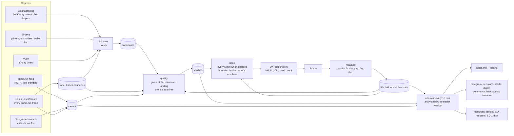

# snipetech — the loop, in one picture

Obsidian renders this diagram; the boxes link to the documents that define them.

Documents: [[roadmap]] (where we stand), [[live-recipe]] (every live test), the design in
`superpowers/specs/2026-11-06-learning-loop-design.md`, the plans under `superpowers/plans/`, [[birdeye]], [[jev]],
[[oktech-features]], [[oktech-settings]]. Live state: the dashboard at `/dash` on the server (phase 1, task 6).
