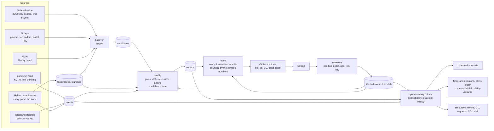

# snipetech — the loop, in one picture

Obsidian renders this diagram; the boxes link to the documents that define them.

Documents: [[roadmap]] (where we stand), [[live-recipe]] (every live test), the design in
`superpowers/specs/2026-11-06-learning-loop-design.md`, the plans under `superpowers/plans/`, [[birdeye]], [[jev]],
[[oktech-features]], [[oktech-settings]]. Live state: the dashboard at `/dash` on the server (phase 1, task 6).

## One database, many writers: every write is a short transaction

Every process on the server writes the same SQLite file (`snipetech.db`, WAL mode): the tape recorder about 100,000
trades an hour, the operator rounds and their jobs (events scan, qualify, the strategy search, the paper test, measure,
book, discover, the strategist). Readers never wait, but only one connection writes at a time, and the recorder waits at
most 20 s for its turn: on 7 Nov a lock held too long, then a refused write left open, stopped the tape for 1 h 45 min
(14:03-15:48), and a paper run that had waited 30 s for the lock died (14:06). So every writer goes through
`Store._write` and commits in short transactions: one row, one trade, one wallet, or a batch of `Store.WRITE_BATCH`
(500) rows, never one transaction across a lab, a network call or a whole table. A write that fails is rolled back at
once (an open transaction keeps the lock and pins the WAL); a refused one is retried for 10 minutes (20 s in the
recorder). The recorder's hourly prune clips the tape's coverage first, then deletes 500 rows per transaction as a task
of its own, the recorder going on in between (measured on a 2.4M-trade copy: another writer waited 2.0 s while one
transaction pruned an hour of tape, 12.4 s for six hours, and 0.08 s at most in batches; the server's database is ten
times larger). Each step of the prune reads at most `Store.PRUNE_SCAN` (5,000) rows, from where the last step stopped,
so a prune reads each old row once, as the single DELETE did. The first batched prune searched again from the oldest row
for every batch: across the trades a list protects, which pile up below the cutoff every day a wallet stays listed, and
through `seen_sigs`, which has no index on ts. Beside 199k protected trades an hour's prune took 43 s of the recorder's
loop, beside 4M 19 minutes in steps of 6 s; now 17 and 27 s in steps of 0.1 s (the single DELETE: 4 and 10 s, the lock
held throughout). Most of what is left is the WAL checkpoints its commits run: 3.3 s instead of 15.8 s with them off,
for an hour with no pile. A reader mid-run sees some of the batches: rows that each stand alone (trades, events,
fingerprints, paper trades, verdicts), so nothing it reads is half made, and during a prune a tape that starts at the
cutoff with some older rows still outside it. A job that dies leaves whole batches, never half of one, and its next run
writes the rest. A new index on a big table, or a table rebuilt, holds the lock for the whole build: run it once by hand
at a quiet hour, never as a line in `SCHEMA` that every process runs when it opens the database.
`tests/test_short_writes.py` guards the rule: a second connection writes while each writer is mid-run.

## Our own exit: /sell sells on the curve and, since 7 Nov, on PumpSwap

`/sell` in Telegram, the unsold-coin watch's `/sell` line and `snipetech sweep` sell a coin from the sniper wallet with
SNIPER_SECRET (`solana/sell.py`) when OKTech leaves it unsold (4siK on 5 Nov, DTAU and 5m5h on 6 Nov). They never buy,
never sell a coin the wallet does not hold, and never sell more than it holds. Each sale is a copy of one OKTech landed
from our own wallet, re-derived for the coin, with the same compute budget (140,000 units at 7,142,857 micro-lamports);
no account list is written from memory:

- A coin still on its curve: `sell_v3`, from `tests/fixtures/pump_sell_v3_template.json` (5 Nov 20:04 UTC).
- A coin that has left its curve: `sell_v2` on its PumpSwap pool, from `tests/fixtures/pumpswap_sell_template.json`,
  OKTech's own auto-sell of `2NgdUjFY…pump` (6 Nov 05:15:55 UTC, slot 465988077, signature
  `4msjkqRb2vciUqWGr6KVnbgw8x189hc2mDNF8NeTXR2N6yWwRFJmh1gi5yJJSwaMzFvzD8myicR4yYu4rvVry6w7`, 0.0549 WSOL). It matters
  because the live book copies 7aPo3n, who buys at 79-93 % of the curve: 11 of 28 earlier copies of such leaders
  completed their curve within 18-86 s.

How a PumpSwap coin is sold:

1. **The pool.** pump.fun's migration puts the coin in the pool at the coin's own PumpSwap address (index 0, created by
   pump.fun's pool authority for the coin, quoted in SOL). The tape's migration record must name the same pool; two
   pools on record is a refusal, never a guess. With no record (the tape was down), the chain must show that pump.fun's
   pool authority made that pool for this coin and SOL. Side pools on the tape are never candidates.
2. **The quote,** from one RPC call: the pool's two token accounts, its virtual SOL reserve (boost pools carry one), the
   coin's supply and pump.fun's fee config. The arithmetic is PumpSwap's own: the swap rounds down, and the LP, protocol
   and creator fees each round up, at the rates of the fee tier of the pool's market cap (`idl/pump_fees.json`). It
   matches the template's sale and a 27 Oct sale to the lamport. On 7 Nov about 21:00 UTC, 66 trades on 27 such pools
   were each charged their tier, and 63 sells paid exactly this arithmetic.
3. **The sale:** the whole holding, with a floor at half the quote from `/sell`. The pool pays in WSOL into the wallet's
   WSOL account, as OKTech's sale did. The account is left open, as OKTech left it: OKTech trades from it (6 Nov 15:08 it
   wrapped 0.0996 SOL into it), and the book and the guard count WSOL as SOL.

Refused, with the reason in the reply: no pool yet (the move lands a slot or more after the curve completes), two
pools on record, a pool that is not the coin's, a cashback coin (PumpSwap sells those only with its older `sell`, and we
hold no landed copy of one), a wallet without a WSOL account (the template creates none), a coin held outside the
wallet's own token account, and a pool that would pay nothing.

`sell_v2` takes 17 accounts. Six depend on the coin: the pool, the coin, the wallet's coin account, the pool's two token
accounts, and the coin's token program. Three are our wallet's: the wallet, its WSOL account, and its volume
accumulator. The other eight are the same for every sale: PumpSwap's global config, the WSOL mint, the token and system
programs, the fee config, the buyback recipient's WSOL account, the event authority and PumpSwap itself. The PumpSwap
IDL account on the chain (`5fLnXN…`, read 7 Nov) is stale: it has `sell` but not `sell_v2`. The public IDL
(pump-public-docs, vendored trimmed in `idl/pump_amm.json`) and the official SDK 2.2.0 have `sell_v2` with the
template's discriminator, accounts, order and flags. `tests/test_sell_pumpswap.py` holds all of it to the template
byte for byte, and to a second landed `sell_v2` on another pool account for account.
