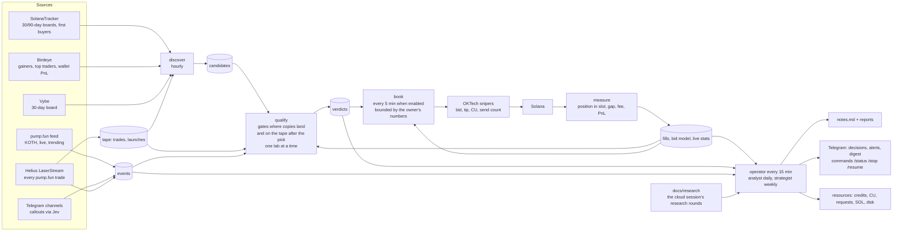

# snipetech — the loop, in one picture

Obsidian renders this diagram; the boxes link to the documents that define them.

Documents: [[roadmap]] (where we stand), [[live-recipe]] (every live test), the design in
`superpowers/specs/2026-11-06-learning-loop-design.md`, the plans under `superpowers/plans/`, [[birdeye]], [[jev]],
[[oktech-features]], [[oktech-settings]]. Live state: the dashboard at `/dash` on the server (phase 1, task 6).

## Which wallets the book may copy: verdicts scored where copies land, and checked after the pick (7 Nov)

Research round 2 found that copy verdicts did not carry forward: the 27 wallets the verdicts and the 14:00 search rated
positive lost 0.0147 SOL a copy on the tape recorded after their verdicts (257 copies), after making +0.063 a copy in
the 6 h before them. The verdicts caught hot streaks that then stopped. So the qualify stage now asks three more things
of a wallet before the book may copy it. First, its copies are scored where live copies land: behind the 3rd buy after
the leader's, whatever slot that buy is in ("+3x"), not up to six trades behind it inside the leader's own slot ("+6"),
which put a leader alone in its slot right behind its own buy. Only a worse landing measured live moves it, never a
closer one. Waiting for the 3rd buy is only ever worse for the copy: where holders sell right after the leader's buy,
the 3rd buy can come after the dump, at a price no live copy got (the review of 7 Nov found a losing wallet that won
every copy that way), so the copy then enters right behind the leader; and it never enters inside the coin's create
slot. The exit is the one OKTech runs: sell after 1 s without a trade, at -30 %, after 300 s, or when the leader sells
half its bag. Second, a
wallet with 10 % or more of its first buys in a coin's create slot is not copied: two of the search's best rows were
such artifacts. Third, the forward check: a wallet must also pass on its own copies after it was picked, at least 20
of them over at least 6 h of later tape, with a lower bound above 0. Copies that lose there retire it. Until then it is
"forward pending" and not copied; 16 of 24 verdict wallets never bought again within 9-13 h. Picked means its latest
pick: a wallet that failed a gate and passes them again on a new streak is picked again, so the streak that brought it
back never counts as its forward copies, and its copies since its first pick must not lose either. The tape keeps 3 to
30 days, so each run keeps the wallet's copies since its first pick with its working data (scores "qualify", `record`)
and judges the ones the tape no longer holds from there. Each verdict carries these numbers (`forward`, `create_slot`).
Nothing in what the book arms changed: it still copies only qualified wallets. A wallet it copied before these rules is
not stopped by them while one of its own snipers still buys for it, which each book run records from OKTech's task
statuses (`book:copying`: running or starting; a stopped sniper keeps its local row, so rows never decide it): its
verdict stays the one the book armed it on and says it no longer qualifies, or, meeting these rules, keeps at least the
score it was armed on so the book's bar never drops it (`kept_armed`); whether it goes is the owner's decision. The
measure stage now records, for each live copy, where on its curve the leader bought (`fills.leader_progress`), next
to the trades behind and the price gap, so live landings can be read by curve progress (7aPo3n, buying at 79-93 %, was
copied 0-1 trades behind).

## One database, many writers: every write is a short transaction

Every process on the server writes the same SQLite file (`snipetech.db`, WAL mode): the tape recorder about 100,000
trades an hour, the operator rounds and their jobs (events scan, qualify, the strategy search, the paper test, measure,
book, discover, the strategist). Readers never wait, but only one connection writes at a time, and the recorder waits at
most 20 s for its turn: on 7 Nov a lock held too long, then a refused write left open, stopped the tape for 1 h 45 min
(14:03-15:48), and a paper run that had waited 30 s for the lock died (14:06). So every writer goes through
`Store._write` and commits in short transactions: one row, one trade, one wallet, or a batch of `Store.WRITE_BATCH`
(500) rows, never one transaction across a lab, a network call or a whole table. A write that fails is rolled back at
once (an open transaction keeps the lock and pins the WAL); a refused one is retried for 10 minutes (20 s in the
recorder). The recorder's hourly prune clips the tape's coverage first, then deletes 500 rows per transaction as a task
of its own, the recorder going on in between (measured on a 2.4M-trade copy: another writer waited 2.0 s while one
transaction pruned an hour of tape, 12.4 s for six hours, and 0.08 s at most in batches; the server's database is ten
times larger). Each step of the prune reads at most `Store.PRUNE_SCAN` (5,000) rows, from where the last step stopped,
so a prune reads each old row once, as the single DELETE did. The first batched prune searched again from the oldest row
for every batch: across the trades a list protects, which pile up below the cutoff every day a wallet stays listed, and
through `seen_sigs`, which has no index on ts. Beside 199k protected trades an hour's prune took 43 s of the recorder's
loop, beside 4M 19 minutes in steps of 6 s; now 17 and 27 s in steps of 0.1 s (the single DELETE: 4 and 10 s, the lock
held throughout). Most of what is left is the WAL checkpoints its commits run: 3.3 s instead of 15.8 s with them off,
for an hour with no pile. A reader mid-run sees some of the batches: rows that each stand alone (trades, events,
fingerprints, paper trades, verdicts), so nothing it reads is half made, and during a prune a tape that starts at the
cutoff with some older rows still outside it. A job that dies leaves whole batches, never half of one, and its next run
writes the rest. A new index on a big table, or a table rebuilt, holds the lock for the whole build: run it once by hand
at a quiet hour, never as a line in `SCHEMA` that every process runs when it opens the database.
`tests/test_short_writes.py` guards the rule: a second connection writes while each writer is mid-run.

## Bulk writers let the recorder in; the recorder's checkpoints run on a thread of their own (8 Nov)

Short transactions were not enough. 7 Nov 23:35:25 the recorder logged that one database call (its transaction writes)
held its event loop for 14.2 s, its streams waiting (22.5 s of the last 60 in database calls). Nobody had held the lock
5 s: the events scan was ending, and its last step wrote 185,251 events as about 371 batches of 500 committed back to
back, after 190,905 `paid_by_dev` edges written one transaction each. SQLite's busy handler polls a waiting writer only
every 100 ms once it has waited about a quarter of a second, and the next batch's `BEGIN IMMEDIATE` came at once after
each commit, so the recorder lost nearly every race. Now `Store._many` pauses `Store.BATCH_YIELD_SECS` (0.15 s, longer
than that poll) between two of its batches, outside any transaction, so a waiting writer gets in after one batch, not
after the whole run (0.15 s a batch: about a minute on that scan). The pause is at least twice the last batch's hold,
plus up to 0.1 s at random: a review on 8 Nov reproduced two bulk writers whose batches held the lock as long as a fixed
pause taking turns, each one's pause covering the other's batch, and a third writer asking once waited 1.4-8.6 s. The recorder turns the pause off for itself: it is the
writer the others pause for, and a pause in its writes would be a sleep on its event loop. The tight loops of one-row
writes in jobs that run beside it now go through `_many` too: the events scan's `paid_by_dev` edges
(`Store.upsert_edges`, the same sums as one `upsert_edge` a transfer, a repeat inside one batch included), discover's
candidates, qualify's verdicts without tape and its labels, the SolanaTracker scores, `label-file`, and the ingestor's
rows of a fetched chunk (six writes a transaction before, one of each kind a chunk now).

7 Nov 23:37:33 "a write held the database's write lock for 6.9 s (live.py:950 _on_tx)": the recorder's own write of a
few pool rows, while a lab read the hourly copy and the disk was busy. 8 Nov 04:37:35 again: 5.7 s for its flush, its
event loop held 6.5 s (10.0 s of the last 60 in database calls). SQLite runs its automatic checkpoint (PASSIVE, once a
commit leaves 1,000 pages in the WAL) inside the committing call, and `Store._write` times the commit, so a slow
checkpoint reads as a slow write. The recorder's connection now sets `wal_autocheckpoint=0`, and a thread of its own
(`live.Checkpointer`), on a connection of its own and never under the store's lock, runs a PASSIVE checkpoint every 5 s,
or sooner once 1,000 frames wait to be copied back (read from the `-shm` wal-index). Each is timed; one of 2 s or more
is logged as "tape: a checkpoint took N s (... frames ...)". The next slow commit then says which it is: a slow write
logs "held the database's write lock" with no slow checkpoint beside it, a slow disk logs the checkpoint. If the thread
copies nothing back for 60 s (it fails or has died), the recorder's commits checkpoint again as SQLite's default does
until it recovers, so the WAL never grows without bound; `journal_size_limit` stays on every connection. Copying back is
not enough on its own (review, 8 Nov, reproduced): SQLite starts the WAL over only when a write begins after a checkpoint
copied every frame back, and commits every 10 ms beside the thread landed inside each PASSIVE checkpoint, so the -wal
grew past 85 MB in 31 s with the thread healthy. So the recorder's commits also take checkpoints back while the WAL holds
more frames than `journal_size_limit` trims it to (16,384); their checkpoint runs while that connection appends nothing,
so the WAL starts over, and the log says "tape: the WAL holds N frames and has not started over ...". Every other
process keeps SQLite's default. `tests/test_bulk_yield.py` and `tests/test_checkpointer.py` guard both.

The recorder's own writes still run on its event loop, under the store's lock its reads share. Moving them to a writer
thread of their own is left for later (decided 8 Nov 05:10): it changes every read on the loop that must see rows not yet
written (a closed launch, the recent migrations), the refused-write, reopen and exit-75 path, and the last flush at
shutdown, the riskiest change to the tape there is. The pause and the checkpoint thread remove the two causes the logs
showed; if the recorder's commits are still slow with no slow checkpoint logged, that writer thread is the next step.

## Every read of the live file is short; the heavy readers read the hourly copy

A read holds its snapshot of the database until its last row. While it is open, no checkpoint can copy the WAL's newer
pages back into the file, and the WAL cannot start over from its beginning, so the `-wal` file grows with everything
the recorder writes. On 7 Nov the database plus its WAL (`db_gb` in `remote status`) grew about 2 GB an hour from 16:00
to 18:00 (15.1 to 19.3 GB, 11.3 before 14:03) and never shrank. The long reads behind it, measured on a 2.4M-trade copy
of the server's shape (the server holds 11M trades, mostly outside the memory its processes may use): discover's count
of buys by wallet and its hottest coins each walk the whole trades table through one index (14 s and 4 s cold; on the
server discover ran 34-50 minutes with 7-13 minutes of CPU and was killed at its 50-minute limit at 17:57 and 18:57),
the events scan walks it again (4 s, then a read per coin; one scan ran 16:46-17:18), and `paper freeze` ran a whole
lab on the live file (its list of a day's coins alone: 10 s). Those read `snipetech.ro.db` now, the copy `snapshot-db`
writes every hour (`Service.tape_store`, when it is under two hours old; the live file only when there is none): a
tape up to two hours old is fine for wallet discovery, research events and labs, and what they find on it is what they
found on the live file. Their results (candidates, events, frozen strategies) still go to the live file. The readers
that need the newest trades (the book, measure, the live and automatic tests, the paper test, the qualify gates) read
the live file in short reads: one wallet, one coin, or a span in pieces of `Store.READ_SPAN_SECS` (ten minutes; a day
of coins in 144 reads of at most 0.15 s instead of one of 9 s, the same answer), each read whole before the work on it.
`remote sql` and the analyst's `sql` tool stop a query at 30 s. The hourly copy is itself one read of the whole file,
8-10 minutes an hour (18:33:07-18:41:56 on 7 Nov); the backup API pins as long, so it stays. Every connection sets
`journal_size_limit` (64 MiB): once the WAL starts over, the file shrinks back instead of keeping its high-water mark.
`tests/test_short_reads.py` guards the rule: while each reader is mid-run, inside its longest read or between two, a
second connection checkpoints, and every frame must be checkpointed.

Nothing writes the copy once it holds its path. Its readers open it read-only and immutable (SQLite reads the file
alone: no lock, and no `-wal` or `-shm` beside it is ever opened), and a lab takes it only once it holds the lab lock,
so a wait behind another lab never leaves it on a copy that has been replaced since. `snapshot-db` hands each copy over
with the code's whole schema, in rollback mode, and clears what an older job left beside the last one. Until 7 Nov
evening the tape store opened the copy read-write: its schema step put the copy in WAL mode, a deploy's new table went
into a `-wal` under the copy's name, and the next copy renamed over it was read on top of that `-wal` ("database disk
image is malformed" for every heavy reader until the copy after, and on disk too once they had closed). A copy taken
before a deploy that added a table or a column is not read: the live file is, until the next copy.
`tests/test_tape_store.py` and `tests/test_snapshot_db.py` guard it.

## The lab: a coin that leaves its curve while held is scored on each exit that sold before (8 Nov)

A position still held when its coin migrates sells on PumpSwap, and the tape holds a coin's PumpSwap trades only where
the recorder's recent-migrations mode ran (coverage `tape:amm_recent`: from 7 Nov 12:13 UTC, with about 23 holes in the
48 h to 7 Nov 23:30). Until 8 Nov a lab with a migration sell among its exits (every lab on the search grid, every hunt
lab) left such a moment out whole, for every exit, wherever the PumpSwap tape lacked the migration. Research round 3
measured the cost: lab 20261107-233005-63076f skipped 7 of its 29 firings, and 5 of them were coins that completed 28-130 s
after the launch, every one a winner at 20 s (+0.055 to +0.100 SOL); round 2's 10/6/1 lab dropped 29 of 838. Short-exit
hunt labs read 0.6-3.7 points of gross too low, about 0.001-0.007 SOL a trade.

Now each exit counts on its own (`lab.exit_pnls`):

- An exit whose every sale landed before the coin left its curve is scored on the curve tape. A 20 s timer on a coin
  that migrates at 60 s is scored. "Landed before" means priced on a trade before the completing buy and landed in its
  slot at the latest; a timer prices on the block clock and lands by the slot clock, so both are checked.
- An exit still holding when the coin left its curve is scored only where the PumpSwap tape holds the migration through
  its own timer. A 300 s hold on the same coin is left out on that moment, and the lab says why.
- A timer due after the curve completed but before the migration (the two are 1-10 slots apart) is priced on a curve
  that takes no sale. It is scored only where the PumpSwap tape holds the stretch from the completion to its sale
  (`lab.exit_gap`; review, 8 Nov: a 59 s timer on a coin completing at 58 s and migrating at 62 s read +2.1 SOL on a
  0.2 SOL buy, about 10x, where a 57 s timer made +0.06).
- A moment no exit can be scored on is left out whole, as before.
- Only launch-type firings (launch, hunt, whale, burst) are scored exit by exit. A copy or a momentum entry whose coin
  migrates without PumpSwap tape is still left out whole: riding into the migration is no known winner for them, so
  exits read on different moments would be compared on samples the coins chose.

The paper test applies the same rule to a frozen exit with a migration sell. Nothing changes where the PumpSwap tape
holds the migration, where nothing migrates while held, for MIG, or in a lab without a migration sell among its exits
(the qualify lab's menu). The lab's report says, per trigger, how many firings were left out whole, how many were scored
on some exits only and how many exit scores were left out, and why.

`rank` reads each exit on the moments it was scored on and says on how many of the trigger's moments the chosen exit
was scored (`exit_moments`, which `paper freeze` keeps). An exit competes only when it was scored on at least 12 of the
trigger's older moments (the fewest a trigger is ranked on, by default) and on half of them. The older moments alone
pick the exit, and they compare the competing exits on the older moments every one of them was scored on: a long hold
read only on the coins that did not migrate would otherwise beat a short timer read on all of them (review, 8 Nov: the
hold won at +0.012 a trade over the timer's +0.0003, though on the same moments the timer made +0.013). The pick's test
numbers are those of all its newer moments that were scored. If the pick was scored on fewer than 8 of the newer moments, or on fewer than half of them, the trigger
is not ranked; no other exit takes its place. Otherwise the newer moments would choose which exit they judge.

One caution: the moments an exit misses are the coins it rode into their migration, so they were chosen by how each
coin went. Where many are missing, its numbers lean on its quick sales; `exit_moments` shows how many. On the grid's
hunt labs the 300 s exits miss 3-24 % of moments. `tests/test_lab_mig_skip.py` guards all of this.

## Our own exit: /sell sells on the curve and, since 7 Nov, on PumpSwap

`/sell` in Telegram, the unsold-coin watch's `/sell` line and `snipetech sweep` sell a coin from the sniper wallet with
SNIPER_SECRET (`solana/sell.py`) when OKTech leaves it unsold (4siK on 5 Nov, DTAU and 5m5h on 6 Nov). They never buy,
never sell a coin the wallet does not hold, and never sell more than it holds. Each sale is a copy of one OKTech landed
from our own wallet, re-derived for the coin, with the same compute budget (140,000 units at 7,142,857 micro-lamports);
no account list is written from memory:

- A coin still on its curve: `sell_v3`, from `tests/fixtures/pump_sell_v3_template.json` (5 Nov 20:04 UTC).
- A coin that has left its curve: `sell_v2` on its PumpSwap pool, from `tests/fixtures/pumpswap_sell_template.json`,
  OKTech's own auto-sell of `2NgdUjFY…pump` (6 Nov 05:15:55 UTC, slot 465988077, signature
  `4msjkqRb2vciUqWGr6KVnbgw8x189hc2mDNF8NeTXR2N6yWwRFJmh1gi5yJJSwaMzFvzD8myicR4yYu4rvVry6w7`, 0.0549 WSOL). It matters
  because the live book copies 7aPo3n, who buys at 79-93 % of the curve: 11 of 28 earlier copies of such leaders
  completed their curve within 18-86 s.

How a PumpSwap coin is sold:

1. **The pool.** pump.fun's migration puts the coin in the pool at the coin's own PumpSwap address (index 0, created by
   pump.fun's pool authority for the coin, quoted in SOL). The tape's migration record must name the same pool; two
   pools on record is a refusal, never a guess. With no record (the tape was down), the chain must show that pump.fun's
   pool authority made that pool for this coin and SOL. Side pools on the tape are never candidates.
2. **The quote,** from one RPC call: the pool's two token accounts, its virtual SOL reserve (boost pools carry one), the
   coin's supply and pump.fun's fee config. The arithmetic is PumpSwap's own: the swap rounds down, and the LP, protocol
   and creator fees each round up, at the rates of the fee tier of the pool's market cap (`idl/pump_fees.json`). It
   matches the template's sale and a 27 Oct sale to the lamport. On 7 Nov about 21:00 UTC, 66 trades on 27 such pools
   were each charged their tier, and 63 sells paid exactly this arithmetic.
3. **The sale:** the whole holding, with a floor at half the quote from `/sell`. The pool pays in WSOL into the wallet's
   WSOL account, as OKTech's sale did. The account is left open, as OKTech left it: OKTech trades from it (6 Nov 15:08 it
   wrapped 0.0996 SOL into it), and the book and the guard count WSOL as SOL.

Refused, with the reason in the reply: no pool yet (the move lands a slot or more after the curve completes), two
pools on record, a pool that is not the coin's, a cashback coin (PumpSwap sells those only with its older `sell`, and we
hold no landed copy of one), a wallet without a WSOL account (the template creates none), a coin held outside the
wallet's own token account, and a pool that would pay nothing.

`sell_v2` takes 17 accounts. Six depend on the coin: the pool, the coin, the wallet's coin account, the pool's two token
accounts, and the coin's token program. Three are our wallet's: the wallet, its WSOL account, and its volume
accumulator. The other eight are the same for every sale: PumpSwap's global config, the WSOL mint, the token and system
programs, the fee config, the buyback recipient's WSOL account, the event authority and PumpSwap itself. The PumpSwap
IDL account on the chain (`5fLnXN…`, read 7 Nov) is stale: it has `sell` but not `sell_v2`. The public IDL
(pump-public-docs, vendored trimmed in `idl/pump_amm.json`) and the official SDK 2.2.0 have `sell_v2` with the
template's discriminator, accounts, order and flags. `tests/test_sell_pumpswap.py` holds all of it to the template
byte for byte, and to a second landed `sell_v2` on another pool account for account.

## Why a live trip won or lost: the post-mortem's arithmetic is code's

The owner, 7 Nov 22:05: "pnl matters but dont stop the bot" and "just make it understand why it lost and how to do
better". The post-mortem already put each lost trip in one cause and wrote lessons and ideas, but the sums were the
model's, and the tool it read them from added up `fills.pnl_sol`, which keeps a sell's failed duplicate sends apart in
`twin_fee_sol`: over the 58 recorded sells of 5-7 Nov it said -1.0419 SOL and 7 winning trips, where the whole result
was -1.2142 and 5 (9gBmZ4 and the control FqK7tC trip were losses).

`measure/attribution.py` breaks every live round trip (a landed sell and the buys it closed, first in first out as
measure pairs them) into parts that add up exactly to its whole result:
`result = price move - venue fee - buy fees - sell fees - failed duplicate sells`. The price move is the sell's quote
less the buy's on the tape, before any fee; the venue fee is pump.fun's 1.25 % a side (the pool's fee once a coin
trades on PumpSwap), also from the tape; the buy and sell fees are the priority fee, tip and base fee of the two
transactions that landed; the duplicates are measure's `twin_fee_sol`. The whole result has one definition,
`trip_result_sol` (pnl_sol less twin_fee_sol), and every reader of live results uses it: the day stop, the automatic
test's blocks, the post-mortem, `read_fills`, the fee-test report and the strategist's weekly evidence (the last four
summed pnl_sol alone before). measure still stores the two apart. Each trip is marked `won`, `lost_to_costs` (it made
money on the price and the costs took it) or `lost_on_price`; `flips` names the single costs whose removal would have
made it a win; the exit that ran is set against the best exit on the menu in measure's replay, replay to replay.

What each change would have saved on the same trips, and who can make it (`strategist/bounds.py strategist_may_set`:
the strategist only while `[autotune]` is on and its overlay would apply the change):

| change | what it saves on a trip | who |
|---|---|---|
| OKTech sends each exit once (one signed sell, not up to three) | every failed duplicate | OKTech, asked by the owner |
| the sell fee back to 0.001 SOL (`[oktech] sell_fee_sol`) | the landed sell's tip above 0.001 and the same on each duplicate that fee priced | the owner |
| OKTech's minimum bid (0.001 priority + 0.002 tip) | the buy's excess, and its priority again on the landed sell and on tipped duplicates | the strategist for a raised control tip, else the owner |
| one exit on the menu for every copy | nothing it can promise: its replay against the replay of the exit that ran is hindsight, a test and never a saving; a code change, since no setting runs one exit on every copy | the owner |

pump.fun's fee and the price have no lever. The causes are what each part took: each cost in all, and the price on
the trips where it fell, never net of the ones where it rose (the 7 Nov review: over the 58 sells of 5-7 Nov the falls
took 0.9222 SOL and CAT's +0.52 left a net of -0.26, which had put the buys' fees first). The analyst's
`read_round_trips` returns each trip's breakdown and the batch's causes ranked by SOL and changes ranked by what they
would have saved, the exit last and marked `test_only`, with how many copies it differed on; its instructions say to
use those numbers as they are, rank the causes and name the change that would have saved the most. After every turn
that reviewed new live trips, code sends the owner a short summary (`operator/postmortem.py`, called by the round once
the trips are marked reviewed): the trips, the price move before any cost, what the fees and the duplicates cost, the
net, the biggest cause and the change that would have saved the most with who can make it; when the price itself took
the most, the analyst's top idea of the turn comes first, an idea it added before one it only moved. An idea is the
owner's to approve unless it is research the agents run themselves: an idea names no key the code could check
against the strategist's bounds. An exit is named only as "Worth testing", after the savings, and only once it beat the
exit that ran on at least 8 copies where the two differed (`EXIT_MIN_TEST`, the book's own bar before a sniper runs
another exit than lab), better on most of them, in the batch and over every copy measure replayed (`exit_record`).
Telegram, and one line in `operator/notes.md`; no wallet balance, no key, nothing that changes a setting. For the copies
of 7aPo3n of 7 Nov 19:18-19:22: price +0.0294 SOL, pump.fun 0.0152, buys 0.0090, landed sells 0.0090, 4 failed
duplicate sells 0.0080, net -0.0119; OKTech sending each exit once would have saved 0.0080, the sell fee at 0.001
0.0070; hold60 replayed 0.0020 better on one copy of three, so the owner does not hear of it
(`tests/test_measure_attribution.py`, `tests/operator/test_postmortem.py`).

What no trip holds, because no fills row has it (the 7 Nov investigation): the seed-account sweeps of 5-6 Nov (0.0592
SOL, gone since the seed account was turned off), two PumpSwap trips of 6 Nov morning that the tape did not record,
failed buys outside any trip, and the token-account rent each buy parks (0.00151384 SOL) until the owner closes the
accounts in Axiom, which returns 99 % of it.

## What the agents remember: lessons, ideas and, since 8 Nov, the research record

The operator, the analyst and the strategist share one memory, and every turn's message carries it: the book's
current settings, the last ten lessons (`operator/lessons.md`, one dated line each with its evidence and n), the five
best open ideas (`operator/ideas.json`) and the research record: the newest research round's OUTCOME paragraph and
its lessons, then one line for each older round from `docs/research/README.md` (`operator/learning.py`,
`research_record`: about 2,500 characters on a cap of its own, each line cut like a lesson's). The research loop
already read the agents' lessons, ideas and reports; the agents never read its rounds, and that cost a night: from
7 Nov 21:16 to 23:16 the analyst froze two creator-0 hunts into the paper test (idea I8 as f94add343f, I6 as
7d6b4302ff) and started a lab for a third (I9), while round 3 (8 Nov 00:00) showed both frozen hunts lose on unseen
4-5 Nov tape (-0.0099 a trade on 19 firings, -0.0553 on 8). The record comes from the checkout the server runs:
`deploy/setup.sh` installs the package editable from `/opt/snipetech`, the operator's unit passes it as `--repo`, and
`remote update` resets that checkout to the branch, docs included; a checkout without `docs/research` gives no block,
never an error. The operator and the analyst can read a whole report with `read_file docs/research/<name>.md`: only a
plain `.md` name in that directory, never another document or repo file, and no tool writes there. Their rules say
the record settles ideas too: an angle a round refuted is not tested again (no lab, no freeze into the paper test), an
open idea a round refutes is marked rejected with the round and its numbers, and a round's builds and questions for
the owner stay with the cloud session and the owner; the strategist never turns a proposed build into a patch.
