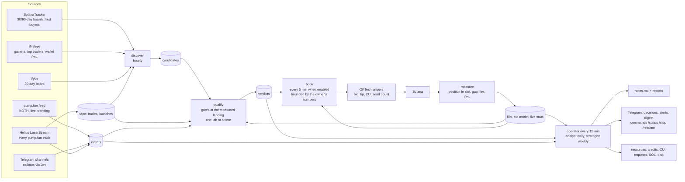

# snipetech — the loop, in one picture

Obsidian renders this diagram; the boxes link to the documents that define them.

Documents: [[roadmap]] (where we stand), [[live-recipe]] (every live test), the design in
`superpowers/specs/2026-11-06-learning-loop-design.md`, the plans under `superpowers/plans/`, [[birdeye]], [[jev]],
[[oktech-features]], [[oktech-settings]]. Live state: the dashboard at `/dash` on the server (phase 1, task 6).

## One database, many writers: every write is a short transaction

Every process on the server writes the same SQLite file (`snipetech.db`, WAL mode): the tape recorder about 100,000
trades an hour, the operator rounds and their jobs (events scan, qualify, the strategy search, the paper test, measure,
book, discover, the strategist). Readers never wait, but only one connection writes at a time, and the recorder waits at
most 20 s for its turn: on 7 Nov a lock held too long, then a refused write left open, stopped the tape for 1 h 45 min
(14:03-15:48), and a paper run that had waited 30 s for the lock died (14:06). So every writer goes through
`Store._write` and commits in short transactions: one row, one trade, one wallet, or a batch of `Store.WRITE_BATCH`
(500) rows, never one transaction across a lab, a network call or a whole table. A write that fails is rolled back at
once (an open transaction keeps the lock and pins the WAL); a refused one is retried for 10 minutes (20 s in the
recorder). The recorder's hourly prune clips the tape's coverage first, then deletes 500 rows per transaction as a task
of its own, the recorder going on in between (measured on a 2.4M-trade copy: another writer waited 2.0 s while one
transaction pruned an hour of tape, 12.4 s for six hours, and 0.08 s at most in batches; the server's database is ten
times larger). A reader mid-run sees some of the batches: rows that each stand alone (trades, events, fingerprints,
paper trades, verdicts), so nothing it reads is half made, and during a prune a tape that starts at the cutoff with some
older rows still outside it. A job that dies leaves whole batches, never half of one, and its next run writes the rest.
A new index on a big table, or a table rebuilt, holds the lock for the whole build: run it once by hand at a quiet hour,
never as a line in `SCHEMA` that every process runs when it opens the database. `tests/test_short_writes.py` guards the
rule: a second connection writes while each writer is mid-run.
