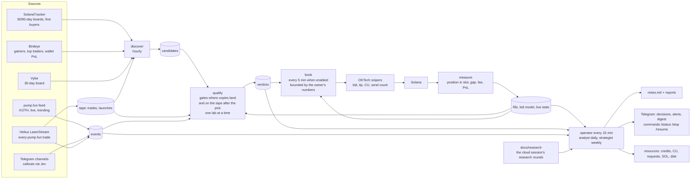

# snipetech — the loop, in one picture

Obsidian renders this diagram; the boxes link to the documents that define them.

Documents: [[roadmap]] (where we stand), [[live-recipe]] (every live test), the design in
`superpowers/specs/2026-11-06-learning-loop-design.md`, the plans under `superpowers/plans/`, [[birdeye]], [[jev]],
[[oktech-features]], [[oktech-settings]]. Live state: the dashboard at `/dash` on the server (phase 1, task 6).

## Which wallets the book may copy: verdicts scored where copies land, and checked after the pick (7 Nov)

Research round 2 found that copy verdicts did not carry forward: the 27 wallets the verdicts and the 14:00 search rated
positive lost 0.0147 SOL a copy on the tape recorded after their verdicts (257 copies), after making +0.063 a copy in
the 6 h before them. The verdicts caught hot streaks that then stopped. So the qualify stage now asks three more things
of a wallet before the book may copy it. First, its copies are scored where live copies land: behind the 3rd buy after
the leader's, whatever slot that buy is in ("+3x"), not up to six trades behind it inside the leader's own slot ("+6"),
which put a leader alone in its slot right behind its own buy. Only a worse landing measured live moves it, never a
closer one. Waiting for the 3rd buy is only ever worse for the copy: where holders sell right after the leader's buy,
the 3rd buy can come after the dump, at a price no live copy got (the review of 7 Nov found a losing wallet that won
every copy that way), so the copy then enters right behind the leader; and it never enters inside the coin's create
slot. The exit is the one OKTech runs: sell after 1 s without a trade, at -30 %, after 300 s, or when the leader sells
half its bag. Second, a
wallet with 10 % or more of its first buys in a coin's create slot is not copied: two of the search's best rows were
such artifacts. Third, the forward check: a wallet must also pass on its own copies after it was picked, at least 20
of them over at least 6 h of later tape, with a lower bound above 0. Copies that lose there retire it. Until then it is
"forward pending" and not copied; 16 of 24 verdict wallets never bought again within 9-13 h. Picked means its latest
pick: a wallet that failed a gate and passes them again on a new streak is picked again, so the streak that brought it
back never counts as its forward copies, and its copies since its first pick must not lose either. The tape keeps 3 to
30 days, so each run keeps the wallet's copies since its first pick with its working data (scores "qualify", `record`)
and judges the ones the tape no longer holds from there. Each verdict carries these numbers (`forward`, `create_slot`).
Nothing in what the book arms changed: it still copies only qualified wallets. A wallet it copied before these rules is
not stopped by them while one of its own snipers still buys for it, which each book run records from OKTech's task
statuses (`book:copying`: running or starting; a stopped sniper keeps its local row, so rows never decide it): its
verdict stays the one the book armed it on and says it no longer qualifies, or, meeting these rules, keeps at least the
score it was armed on so the book's bar never drops it (`kept_armed`); whether it goes is the owner's decision. The
measure stage now records, for each live copy, where on its curve the leader bought (`fills.leader_progress`), next
to the trades behind and the price gap, so live landings can be read by curve progress (7aPo3n, buying at 79-93 %, was
copied 0-1 trades behind).

## The lab and the paper test: a launch rule fires only on its own launchpad (8 Nov)

The lab (`analysis/lab.py`: `_coin_rows` builds each coin's `MarketPath`, `_fire` decides whether a rule fires) and the
forward paper test (`analysis/paper.py`, the same `_fire`) score every rule on the tape. Until 8 Nov a launch, hunt,
whale or burst rule fired on every SOL-quoted launch, Raydium LaunchLab included, while every sniper `oktech.py` builds
sends OKTech `platforms: ["pumpfun"]`. Research round 4 found the damage: LaunchLab was 30-60 % of creator-0 firings on
7-8 Nov, all of paper rule bbe92cca81's profit was LaunchLab coins (+0.095 SOL on 3; its pump.fun coins lost 0.048 on
4), and 6 of f94add343f's 14 trades were.

Now each of those rules has a venue (`Trigger.venue`). `pumpfun`, the default, is what OKTech runs; `launchlab` is a
research option (`--trigger '{"kind": "hunt", ..., "venue": "launchlab"}'`). A coin's venue comes from its trades
(`MarketPath.venue`: LaunchLab if any of its trades is on a LaunchLab curve), and `_fire` returns nothing for a
launch-type rule on a coin of another venue. Copy, momentum and MIG rules have no venue knob. The venue is part of a
rule's id only when it is not the default, so every trigger and frozen strategy keeps its id.

Nothing is deleted. Each new paper trade records its coin's venue (`data.venue`). The first paper run after the deploy
tags the older rows from the tape, once (`paper.tag_venues`, coverage `paper:venues`), so the tags hold after retention
prunes those coins. A frozen rule's record (`paper.record`) counts only its own venue's trades: the paper report, the
digest line, `/test` and the automatic test's 100-trade bar all read it, and the report says how many it left out
(`other_venue`). A row that was never tagged and whose coin the tape no longer holds still counts.

`/test` and the automatic test refuse a rule whose venue its sniper cannot buy (`oktech.venue_refusal`: no OKTech
platform is mapped to LaunchLab), in plain words; `oktech strategy` refuses to build one. Not done yet: MarketPath does
not mark a LaunchLab coin that leaves its curve, and our landing on LaunchLab has never been measured (round 4,
priority 4), so a `launchlab` lab number is research, not evidence.

## One database, many writers: every write is a short transaction

Every process on the server writes the same SQLite file (`snipetech.db`, WAL mode): the tape recorder about 100,000
trades an hour, the operator rounds and their jobs (events scan, qualify, the strategy search, the paper test, measure,
book, discover, the strategist). Readers never wait, but only one connection writes at a time, and the recorder waits at
most 20 s for its turn: on 7 Nov a lock held too long, then a refused write left open, stopped the tape for 1 h 45 min
(14:03-15:48), and a paper run that had waited 30 s for the lock died (14:06). So every writer goes through
`Store._write` and commits in short transactions: one row, one trade, one wallet, or a batch of `Store.WRITE_BATCH`
(500) rows, never one transaction across a lab, a network call or a whole table. A write that fails is rolled back at
once (an open transaction keeps the lock and pins the WAL); a refused one is retried for 10 minutes (20 s in the
recorder). The recorder's hourly prune clips the tape's coverage first, then deletes 500 rows per transaction as a task
of its own, the recorder going on in between (measured on a 2.4M-trade copy: another writer waited 2.0 s while one
transaction pruned an hour of tape, 12.4 s for six hours, and 0.08 s at most in batches; the server's database is ten
times larger). Each step of the prune reads at most `Store.PRUNE_SCAN` (5,000) rows, from where the last step stopped,
so a prune reads each old row once, as the single DELETE did. The first batched prune searched again from the oldest row
for every batch: across the trades a list protects, which pile up below the cutoff every day a wallet stays listed, and
through `seen_sigs`, which has no index on ts. Beside 199k protected trades an hour's prune took 43 s of the recorder's
loop, beside 4M 19 minutes in steps of 6 s; now 17 and 27 s in steps of 0.1 s (the single DELETE: 4 and 10 s, the lock
held throughout). Most of what is left is the WAL checkpoints its commits run: 3.3 s instead of 15.8 s with them off,
for an hour with no pile. A reader mid-run sees some of the batches: rows that each stand alone (trades, events,
fingerprints, paper trades, verdicts), so nothing it reads is half made, and during a prune a tape that starts at the
cutoff with some older rows still outside it. A job that dies leaves whole batches, never half of one, and its next run
writes the rest. A new index on a big table, or a table rebuilt, holds the lock for the whole build: run it once by hand
at a quiet hour, never as a line in `SCHEMA` that every process runs when it opens the database.
`tests/test_short_writes.py` guards the rule: a second connection writes while each writer is mid-run.

## Every read of the live file is short; the heavy readers read the hourly copy

A read holds its snapshot of the database until its last row. While it is open, no checkpoint can copy the WAL's newer
pages back into the file, and the WAL cannot start over from its beginning, so the `-wal` file grows with everything
the recorder writes. On 7 Nov the database plus its WAL (`db_gb` in `remote status`) grew about 2 GB an hour from 16:00
to 18:00 (15.1 to 19.3 GB, 11.3 before 14:03) and never shrank. The long reads behind it, measured on a 2.4M-trade copy
of the server's shape (the server holds 11M trades, mostly outside the memory its processes may use): discover's count
of buys by wallet and its hottest coins each walk the whole trades table through one index (14 s and 4 s cold; on the
server discover ran 34-50 minutes with 7-13 minutes of CPU and was killed at its 50-minute limit at 17:57 and 18:57),
the events scan walks it again (4 s, then a read per coin; one scan ran 16:46-17:18), and `paper freeze` ran a whole
lab on the live file (its list of a day's coins alone: 10 s). Those read `snipetech.ro.db` now, the copy `snapshot-db`
writes every hour (`Service.tape_store`, when it is under two hours old; the live file only when there is none): a
tape up to two hours old is fine for wallet discovery, research events and labs, and what they find on it is what they
found on the live file. Their results (candidates, events, frozen strategies) still go to the live file. The readers
that need the newest trades (the book, measure, the live and automatic tests, the paper test, the qualify gates) read
the live file in short reads: one wallet, one coin, or a span in pieces of `Store.READ_SPAN_SECS` (ten minutes; a day
of coins in 144 reads of at most 0.15 s instead of one of 9 s, the same answer), each read whole before the work on it.
`remote sql` and the analyst's `sql` tool stop a query at 30 s. The hourly copy is itself one read of the whole file,
8-10 minutes an hour (18:33:07-18:41:56 on 7 Nov); the backup API pins as long, so it stays. Every connection sets
`journal_size_limit` (64 MiB): once the WAL starts over, the file shrinks back instead of keeping its high-water mark.
`tests/test_short_reads.py` guards the rule: while each reader is mid-run, inside its longest read or between two, a
second connection checkpoints, and every frame must be checkpointed.

Nothing writes the copy once it holds its path. Its readers open it read-only and immutable (SQLite reads the file
alone: no lock, and no `-wal` or `-shm` beside it is ever opened), and a lab takes it only once it holds the lab lock,
so a wait behind another lab never leaves it on a copy that has been replaced since. `snapshot-db` hands each copy over
with the code's whole schema, in rollback mode, and clears what an older job left beside the last one. Until 7 Nov
evening the tape store opened the copy read-write: its schema step put the copy in WAL mode, a deploy's new table went
into a `-wal` under the copy's name, and the next copy renamed over it was read on top of that `-wal` ("database disk
image is malformed" for every heavy reader until the copy after, and on disk too once they had closed). A copy taken
before a deploy that added a table or a column is not read: the live file is, until the next copy.
`tests/test_tape_store.py` and `tests/test_snapshot_db.py` guard it.

## The lab: a coin that leaves its curve while held is scored on each exit that sold before (8 Nov)

A position still held when its coin migrates sells on PumpSwap, and the tape holds a coin's PumpSwap trades only where
the recorder's recent-migrations mode ran (coverage `tape:amm_recent`: from 7 Nov 12:13 UTC, with about 23 holes in the
48 h to 7 Nov 23:30). Until 8 Nov a lab with a migration sell among its exits (every lab on the search grid, every hunt
lab) left such a moment out whole, for every exit, wherever the PumpSwap tape lacked the migration. Research round 3
measured the cost: lab 20261107-233005-63076f skipped 7 of its 29 firings, and 5 of them were coins that completed 28-130 s
after the launch, every one a winner at 20 s (+0.055 to +0.100 SOL); round 2's 10/6/1 lab dropped 29 of 838. Short-exit
hunt labs read 0.6-3.7 points of gross too low, about 0.001-0.007 SOL a trade.

Now each exit counts on its own (`lab.exit_pnls`):

- An exit whose every sale landed before the coin left its curve is scored on the curve tape. A 20 s timer on a coin
  that migrates at 60 s is scored. "Landed before" means priced on a trade before the completing buy and landed in its
  slot at the latest; a timer prices on the block clock and lands by the slot clock, so both are checked.
- An exit still holding when the coin left its curve is scored only where the PumpSwap tape holds the migration through
  its own timer. A 300 s hold on the same coin is left out on that moment, and the lab says why.
- A timer due after the curve completed but before the migration (the two are 1-10 slots apart) is priced on a curve
  that takes no sale. It is scored only where the PumpSwap tape holds the stretch from the completion to its sale
  (`lab.exit_gap`; review, 8 Nov: a 59 s timer on a coin completing at 58 s and migrating at 62 s read +2.1 SOL on a
  0.2 SOL buy, about 10x, where a 57 s timer made +0.06).
- A moment no exit can be scored on is left out whole, as before.
- Only launch-type firings (launch, hunt, whale, burst) are scored exit by exit. A copy or a momentum entry whose coin
  migrates without PumpSwap tape is still left out whole: riding into the migration is no known winner for them, so
  exits read on different moments would be compared on samples the coins chose.

The paper test applies the same rule to a frozen exit with a migration sell. Nothing changes where the PumpSwap tape
holds the migration, where nothing migrates while held, for MIG, or in a lab without a migration sell among its exits
(the qualify lab's menu). The lab's report says, per trigger, how many firings were left out whole, how many were scored
on some exits only and how many exit scores were left out, and why.

`rank` reads each exit on the moments it was scored on and says on how many of the trigger's moments the chosen exit
was scored (`exit_moments`, which `paper freeze` keeps). An exit competes only when it was scored on at least 12 of the
trigger's older moments (the fewest a trigger is ranked on, by default) and on half of them. The older moments alone
pick the exit, and they compare the competing exits on the older moments every one of them was scored on: a long hold
read only on the coins that did not migrate would otherwise beat a short timer read on all of them (review, 8 Nov: the
hold won at +0.012 a trade over the timer's +0.0003, though on the same moments the timer made +0.013). The pick's test
numbers are those of all its newer moments that were scored. If the pick was scored on fewer than 8 of the newer moments, or on fewer than half of them, the trigger
is not ranked; no other exit takes its place. Otherwise the newer moments would choose which exit they judge.

One caution: the moments an exit misses are the coins it rode into their migration, so they were chosen by how each
coin went. Where many are missing, its numbers lean on its quick sales; `exit_moments` shows how many. On the grid's
hunt labs the 300 s exits miss 3-24 % of moments. `tests/test_lab_mig_skip.py` guards all of this.

## Our own exit: /sell sells on the curve and, since 7 Nov, on PumpSwap

`/sell` in Telegram, the unsold-coin watch's `/sell` line and `snipetech sweep` sell a coin from the sniper wallet with
SNIPER_SECRET (`solana/sell.py`) when OKTech leaves it unsold (4siK on 5 Nov, DTAU and 5m5h on 6 Nov). They never buy,
never sell a coin the wallet does not hold, and never sell more than it holds. Each sale is a copy of one OKTech landed
from our own wallet, re-derived for the coin, with the same compute budget (140,000 units at 7,142,857 micro-lamports);
no account list is written from memory:

- A coin still on its curve: `sell_v3`, from `tests/fixtures/pump_sell_v3_template.json` (5 Nov 20:04 UTC).
- A coin that has left its curve: `sell_v2` on its PumpSwap pool, from `tests/fixtures/pumpswap_sell_template.json`,
  OKTech's own auto-sell of `2NgdUjFY…pump` (6 Nov 05:15:55 UTC, slot 465988077, signature
  `4msjkqRb2vciUqWGr6KVnbgw8x189hc2mDNF8NeTXR2N6yWwRFJmh1gi5yJJSwaMzFvzD8myicR4yYu4rvVry6w7`, 0.0549 WSOL). It matters
  because the live book copies 7aPo3n, who buys at 79-93 % of the curve: 11 of 28 earlier copies of such leaders
  completed their curve within 18-86 s.

How a PumpSwap coin is sold:

1. **The pool.** pump.fun's migration puts the coin in the pool at the coin's own PumpSwap address (index 0, created by
   pump.fun's pool authority for the coin, quoted in SOL). The tape's migration record must name the same pool; two
   pools on record is a refusal, never a guess. With no record (the tape was down), the chain must show that pump.fun's
   pool authority made that pool for this coin and SOL. Side pools on the tape are never candidates.
2. **The quote,** from one RPC call: the pool's two token accounts, its virtual SOL reserve (boost pools carry one), the
   coin's supply and pump.fun's fee config. The arithmetic is PumpSwap's own: the swap rounds down, and the LP, protocol
   and creator fees each round up, at the rates of the fee tier of the pool's market cap (`idl/pump_fees.json`). It
   matches the template's sale and a 27 Oct sale to the lamport. On 7 Nov about 21:00 UTC, 66 trades on 27 such pools
   were each charged their tier, and 63 sells paid exactly this arithmetic.
3. **The sale:** the whole holding, with a floor at half the quote from `/sell`. The pool pays in WSOL into the wallet's
   WSOL account, as OKTech's sale did. The account is left open, as OKTech left it: OKTech trades from it (6 Nov 15:08 it
   wrapped 0.0996 SOL into it), and the book and the guard count WSOL as SOL.

Refused, with the reason in the reply: no pool yet (the move lands a slot or more after the curve completes), two
pools on record, a pool that is not the coin's, a cashback coin (PumpSwap sells those only with its older `sell`, and we
hold no landed copy of one), a wallet without a WSOL account (the template creates none), a coin held outside the
wallet's own token account, and a pool that would pay nothing.

`sell_v2` takes 17 accounts. Six depend on the coin: the pool, the coin, the wallet's coin account, the pool's two token
accounts, and the coin's token program. Three are our wallet's: the wallet, its WSOL account, and its volume
accumulator. The other eight are the same for every sale: PumpSwap's global config, the WSOL mint, the token and system
programs, the fee config, the buyback recipient's WSOL account, the event authority and PumpSwap itself. The PumpSwap
IDL account on the chain (`5fLnXN…`, read 7 Nov) is stale: it has `sell` but not `sell_v2`. The public IDL
(pump-public-docs, vendored trimmed in `idl/pump_amm.json`) and the official SDK 2.2.0 have `sell_v2` with the
template's discriminator, accounts, order and flags. `tests/test_sell_pumpswap.py` holds all of it to the template
byte for byte, and to a second landed `sell_v2` on another pool account for account.

## Why a live trip won or lost: the post-mortem's arithmetic is code's

The owner, 7 Nov 22:05: "pnl matters but dont stop the bot" and "just make it understand why it lost and how to do
better". The post-mortem already put each lost trip in one cause and wrote lessons and ideas, but the sums were the
model's, and the tool it read them from added up `fills.pnl_sol`, which keeps a sell's failed duplicate sends apart in
`twin_fee_sol`: over the 58 recorded sells of 5-7 Nov it said -1.0419 SOL and 7 winning trips, where the whole result
was -1.2142 and 5 (9gBmZ4 and the control FqK7tC trip were losses).

`measure/attribution.py` breaks every live round trip (a landed sell and the buys it closed, first in first out as
measure pairs them) into parts that add up exactly to its whole result:
`result = price move - venue fee - buy fees - sell fees - failed duplicate sells`. The price move is the sell's quote
less the buy's on the tape, before any fee; the venue fee is pump.fun's 1.25 % a side (the pool's fee once a coin
trades on PumpSwap), also from the tape; the buy and sell fees are the priority fee, tip and base fee of the two
transactions that landed; the duplicates are measure's `twin_fee_sol`. The whole result has one definition,
`trip_result_sol` (pnl_sol less twin_fee_sol), and every reader of live results uses it: the day stop, the automatic
test's blocks, the post-mortem, `read_fills`, the fee-test report and the strategist's weekly evidence (the last four
summed pnl_sol alone before). measure still stores the two apart. Each trip is marked `won`, `lost_to_costs` (it made
money on the price and the costs took it) or `lost_on_price`; `flips` names the single costs whose removal would have
made it a win; the exit that ran is set against the best exit on the menu in measure's replay, replay to replay.

What each change would have saved on the same trips, and who can make it (`strategist/bounds.py strategist_may_set`:
the strategist only while `[autotune]` is on and its overlay would apply the change):

| change | what it saves on a trip | who |
|---|---|---|
| OKTech sends each exit once (one signed sell, not up to three) | every failed duplicate | OKTech, asked by the owner |
| the sell fee back to 0.001 SOL (`[oktech] sell_fee_sol`) | the landed sell's tip above 0.001 and the same on each duplicate that fee priced | the owner |
| OKTech's minimum bid (0.001 priority + 0.002 tip) | the buy's excess, and its priority again on the landed sell and on tipped duplicates | the strategist for a raised control tip, else the owner |
| one exit on the menu for every copy | nothing it can promise: its replay against the replay of the exit that ran is hindsight, a test and never a saving; a code change, since no setting runs one exit on every copy | the owner |

pump.fun's fee and the price have no lever. The causes are what each part took: each cost in all, and the price on
the trips where it fell, never net of the ones where it rose (the 7 Nov review: over the 58 sells of 5-7 Nov the falls
took 0.9222 SOL and CAT's +0.52 left a net of -0.26, which had put the buys' fees first). The analyst's
`read_round_trips` returns each trip's breakdown and the batch's causes ranked by SOL and changes ranked by what they
would have saved, the exit last and marked `test_only`, with how many copies it differed on; its instructions say to
use those numbers as they are, rank the causes and name the change that would have saved the most. After every turn
that reviewed new live trips, code sends the owner a short summary (`operator/postmortem.py`, called by the round once
the trips are marked reviewed): the trips, the price move before any cost, what the fees and the duplicates cost, the
net, the biggest cause and the change that would have saved the most with who can make it; when the price itself took
the most, the analyst's top idea of the turn comes first, an idea it added before one it only moved. An idea is the
owner's to approve unless it is research the agents run themselves: an idea names no key the code could check
against the strategist's bounds. An exit is named only as "Worth testing", after the savings, and only once it beat the
exit that ran on at least 8 copies where the two differed (`EXIT_MIN_TEST`, the book's own bar before a sniper runs
another exit than lab), better on most of them, in the batch and over every copy measure replayed (`exit_record`).
Telegram, and one line in `operator/notes.md`; no wallet balance, no key, nothing that changes a setting. For the copies
of 7aPo3n of 7 Nov 19:18-19:22: price +0.0294 SOL, pump.fun 0.0152, buys 0.0090, landed sells 0.0090, 4 failed
duplicate sells 0.0080, net -0.0119; OKTech sending each exit once would have saved 0.0080, the sell fee at 0.001
0.0070; hold60 replayed 0.0020 better on one copy of three, so the owner does not hear of it
(`tests/test_measure_attribution.py`, `tests/operator/test_postmortem.py`).

What no trip holds, because no fills row has it (the 7 Nov investigation): the seed-account sweeps of 5-6 Nov (0.0592
SOL, gone since the seed account was turned off), two PumpSwap trips of 6 Nov morning that the tape did not record,
failed buys outside any trip, and the token-account rent each buy parks (0.00151384 SOL) until the owner closes the
accounts in Axiom, which returns 99 % of it.

## Fees per task (8 Nov)

The owner, 8 Nov 12:35: "Why is it selling twice? Find a fix yourself. Also the agents should decide on the fees
depending on what the specific task is."

**Why it sells twice.** OKTech signs every auto-sell on up to three nonce accounts and sends them all; one lands and
the others fail with pump error 6023 (nothing left to sell), each paying its priority fee plus the 5,000-lamport base
fee, while a failed send's tip is refunded. `extraParams.globalSendCount 1` does not govern exits (verified 6 Nov).
Until 8 Nov one setting, `[oktech] sell_fee_sol` (0.002), priced both the landed sell's tip and every twin's priority:
the three winning copies of 7aPo3n at 12:10–12:20 left four failed twins at 2,000,000 lamports priority each, 0.008
SOL of a 0.119 SOL gross. The fix splits the two: `[oktech] sell_tip_sol` (0.002) is the bid, carried by the tip and
refunded when a send fails; `[oktech] sell_priority_sol` (0.0001) is what each failed twin pays. `sell_fee_sol` stays
readable as a deprecated alias for the bid only: a file that still sets it (the server's may, from the 6 Nov audit
fix) sets `sell_tip_sol` and logs a warning, and never puts the priority back, so the fix deploys whether or not the
owner's file was edited. The split changes one number and nothing else: each builder keeps the sell tip it bid before
(the copy builders and the verdict's dev sniper 0.002, from `sell_tip_sol`; the strategy, replica and speed-test
snipers 0.001, their kinds' `[fees]` minimum). No running sniper is touched: the split reaches a sniper when the book
replaces it (every builder in `oktech.py` sends it from then on). The risk, said plainly: if OKTech's untipped copies
are sometimes what lands when the tipped one loses, a near-zero priority could leave a coin unsold. The unsold-coin
watch and `/sell` cover that; the measure stage counts it (below).

**Fees per task.** `fees.py` gives each planned sniper its four numbers (buy priority, buy tip, sell tip, sell
priority) from its kind (a copy of a given leader, a hunt, a launch sniper, a MIG sniper, a probe) and the evidence on
`fills`, inside the owner's `[fees] bounds` (per kind and number, min and max; defaults at today's values with the
tips' max at 0.005, the autotune bound the control arm's tip already had). The rule of evidence, in the module's
docstring: a tip is raised above the minimum only where 10+ fills at the higher tip landed measurably earlier than 10+
at the lower one (`trades_behind`, else `price_gap_pct`, lower; a one-sided test at the 80 % level); otherwise the
minimum, because the 6 Nov fee test paid 20 times the fee and landed no earlier. Priorities are never raised: the buy
priority is charged again on every exit, the sell priority on every failed twin. Evidence is per kind and, for
copies, per leader: a leader's fills never price another leader's sniper. The book's arm is the floor of a copy's buy
bid (the policy may raise the tip above it on evidence, never lower it); a verdict's recommended bribe is the floor of
a dev sniper's; a bid asked for by hand (`oktech copylist --priority --tip`, the fee test) wins over the policy and is
said so in the sniper's notes. Every planned sniper's notes carry one line: which fee it gets and why. The strategist
may lower a kind's cap (`fees.tune.<kind>.<number>.max`, checked against the owner's outer bounds and never past
them) and never a minimum: a raised minimum would be a raised bid with no fills behind it, the thing the rule
forbids, so a `.min` in its patch or its overlay is refused and ignored (`config.NEVER_TUNABLE_KEYS` unchanged,
`fees.bounds` owner-only). The operator and the analyst read the
policy's current choice per kind and per leader with `read_fee_policy`; the strategist's weekly evidence carries it as
`fee_policy`.

**Measuring whether it worked.** Every fill already records its priority and tip. Measure's run summary now has
`twins_per_sell`: the failed twins' cost per landed sell, grouped by the sell priority setting that priced the twins
(0.002 before the split, 0.0001 after: the sniper's own `sellPriorityFeeSol` when known, else the untipped twins'
priority, since the tipped variant that lost pays the buy's priority and a median of the two lands in no group), and
`sells_per_buy`: landed sells per buy for buys made by snipers at the old and the new sell
priority, a buy counted only once its longest hold (600 s) is over. For the first 20 sells after the split measure
writes one line per new sell to `operator/notes.md`; when the ratio after falls more than 0.15 under the ratio before
(four buys due on each side at least) it writes an ALERT line naming `/sell` and `[oktech] sell_priority_sol`. The
post-mortem's levers carry the same split: the `single_send` lever says the twins' cost per trip at each sell
priority, and the `sell_fee` lever now names `oktech.sell_tip_sol` (`tests/test_fees.py`, `tests/test_measure_run.py`,
`tests/test_oktech.py`).

## Where a live buy landed: from the tape, or from the chain itself (12 Nov)

The measure stage built `fills` from our trades on the tape, and the tape holds pump.fun's curve and PumpSwap for 30
minutes after a coin leaves its curve. A copy of a coin on neither was in no row at all (12 Nov 17:04 UTC, the tip
ladder's first two buys). `measure/chain_landing.py` reads a buy of ours straight from the chain, on any program,
without decoding a swap:

- **our side** from our own balances before and after (the coin, the SOL, the coins got), the fee and tip with the
  decoders `fills` has always used;
- **the copied wallet's buy** of the same coin just before ours, found among its own signatures;
- **the blocks between the two** (`getBlock`, five at the most; more is said): every other signer whose balance of
  the coin rose, in the order the blocks ran them, with what it paid and bid; the buys that failed in between, apart;
  the copied wallet's companions (as the tape knows them) and our own wallets named, never counted;
- **the price** as the SOL the pool took over the coins it gave, the pool being whoever owns the account the coins
  came out of.

A bid is the priority fee plus the tips to catalogued landing services. A payment to an account nobody catalogued is a
tip on our own fills and kept apart on anyone else's (a tip or a bot's fee): when it alone decides, the fill's reading
is `unclear`, never `fees` or `speed`.

The measure stage walks the wallet's own signatures once a run: a landed transaction the tape does not hold becomes a
fill (buy or sell), and a buy that a copy sniper could have made, on or off the tape, that the tape cannot place gets
`trades_behind`, `price_gap_pct`, `blocks_after`, `ahead_bids`, `ahead_bid_max`, `ahead_bid_p50`, `landing_verdict`
and `venue` from the chain; `landing_src` says `tape`, `chain` or `chain-none`. A failed send on a program we do not
decode gets its coin from its balances and is charged to the sell it follows, as a pump.fun twin is. `snipetech
landing --sig <buy> --leader <wallet>` and `landing --wallet <ours> --since-minutes N` print the same reading as a
table; the agents may start it. Built against fixtures and a fake RPC (`tests/chain.py`, `tests/test_chain_landing.py`,
`tests/test_measure_chain.py`); the real answers of `getBlock` and of `getSignaturesForAddress` with another wallet's
transaction as its cursor are first met on the server.

## What the agents remember: lessons, ideas and, since 8 Nov, the research record

The operator, the analyst and the strategist share one memory, and every turn's message carries it: the book's
current settings, the last ten lessons (`operator/lessons.md`, one dated line each with its evidence and n), the five
best open ideas (`operator/ideas.json`) and the research record: the newest research round's OUTCOME paragraph and
its lessons, then one line for each older round from `docs/research/README.md` (`operator/learning.py`,
`research_record`: about 2,500 characters on a cap of its own, each line cut like a lesson's). The research loop
already read the agents' lessons, ideas and reports; the agents never read its rounds, and that cost a night: from
7 Nov 21:16 to 23:16 the analyst froze two creator-0 hunts into the paper test (idea I8 as f94add343f, I6 as
7d6b4302ff) and started a lab for a third (I9), while round 3 (8 Nov 00:00) showed both frozen hunts lose on unseen
4-5 Nov tape (-0.0099 a trade on 19 firings, -0.0553 on 8). The record comes from the checkout the server runs:
`deploy/setup.sh` installs the package editable from `/opt/snipetech`, the operator's unit passes it as `--repo`, and
`remote update` resets that checkout to the branch, docs included; a checkout without `docs/research` gives no block,
never an error. The operator and the analyst can read a whole report with `read_file docs/research/<name>.md`: only a
plain `.md` name in that directory, never another document or repo file, and no tool writes there. Their rules say
the record settles ideas too: an angle a round refuted is not tested again (no lab, no freeze into the paper test), an
open idea a round refutes is marked rejected with the round and its numbers, and a round's builds and questions for
the owner stay with the cloud session and the owner; the strategist never turns a proposed build into a patch.

What changed on 8 Nov (the review of the breakdown):

- **A sell measure cannot pair still costs its duplicates.** When the tape misses our buy (a recorder stall), the sell
  lands with no buy to pair: its `pnl_sol` stays empty, because its price is unknown. Its failed duplicate sends were
  still paid for, and until 8 Nov they were in the measure run's totals only. Now measure writes `twin_fee_sol` on such a
  sell too, and `known_result_sol` (the whole result once paired, else minus the duplicates alone) is what the day
  stop, `read_fills` and the post-mortem's whole result sum. The automatic test's block pays the twins of a sale that
  has no result as the failed sends they are; a paired sale's twins stay in its own result. The owner's summary says
  "Also 1 sell whose buy is not on record (the tape missed it): its price is unknown; its failed duplicate sells cost
  … SOL, counted in the net." Once the buy reaches the tape, measure pairs the sell and keeps the same duplicates:
  each counted once.
- **An unknown fee is charged as measure charges it.** A fill whose fingerprint is unknown costs measure's flat
  `[costs] per_tx_sol` in full on every lot it touches (`pair_round_trips`). The breakdown had scaled it by the share
  closed, so the price part took the difference and a trip near zero could change kind; now it charges the same, and
  the price part is the tape's price again. No 5-7 Nov fill has an unknown fee, so no record changed.
- **A copy bought on the curve and sold by OKTech on PumpSwap.** When the tape holds the sale, it gets its whole
  result as the code stands: the PumpSwap trade is ours on the tape (the event's `user`), measure pairs it first in
  first out with the curve buy by coin, prices it at the WSOL the pool paid out (`quote_amount_out` less the LP,
  protocol and creator fees), ties the failed `sell_v2` duplicates to it (they decode as PumpSwap sells, with the coin
  as `base_mint`), and the breakdown reads each leg's venue fee from the tape
  (`tests/test_measure_run.py::test_a_copy_bought_on_the_curve_and_sold_on_pumpswap_gets_its_whole_result`). When the
  tape does not hold the sale, the trip is in no fill: measure reads our trades from the tape only. The buy then stays
  open, the day stop and the post-mortem never see the trip, the automatic test counts the buy at its whole cost
  after its wait (the proceeds are missed), and the duplicates count as failed sends tied to no sale. That is the
  6 Nov trip of 2NgdUj: its buy (05:15:46) is the one buy in `fills` with no sale, and its PumpSwap sale
  (`4msjkqRb…`, 0.0549 WSOL) is not on the tape; its two failed duplicates (Custom 1) are failed rows. Our wallet has
  no PumpSwap trade on the tape at all (read 8 Nov), and no other buy is open, so no PumpSwap sale has been missed
  since. The tape keeps recent migrations' PumpSwap trades only inside its runs (`tape:amm_recent`): from 7 Nov 12:13
  to 8 Nov 08:47 they covered 84 % of the time, with holes on 7 Nov 14:03-15:49, 19:28-20:49 (several restarts and a
  36-minute skipped stretch) and none since; a coin is kept 30 minutes after its migration. Not built, because it
  needs a source measure does not read: our own landed transactions decoded into trades when the tape has none.
  measure already lists the wallet's signatures (`getSignaturesForAddress`, for the failed sends) and drops the landed
  ones; fetching those the tape lacks and decoding them (as `Ingestor.ingest` does) would close it, but it writes to
  the tape from measure, and `Ingestor.ingest` skips only signatures in `seen_sigs`, which the recorder never marks,
  so it would fetch every landed transaction of ours again each run.
