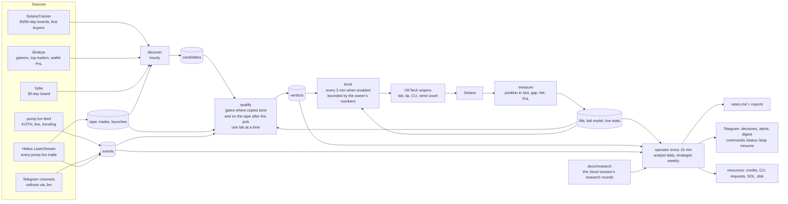

# snipetech — the loop, in one picture

Obsidian renders this diagram; the boxes link to the documents that define them.

Documents: [[roadmap]] (where we stand), [[live-recipe]] (every live test), the design in
`superpowers/specs/2026-11-06-learning-loop-design.md`, the plans under `superpowers/plans/`, [[birdeye]], [[jev]],
[[oktech-features]], [[oktech-settings]]. Live state: the dashboard at `/dash` on the server (phase 1, task 6).

## Which wallets the book may copy: verdicts scored where copies land, and checked after the pick (7 Nov)

Research round 2 found that copy verdicts did not carry forward: the 27 wallets the verdicts and the 14:00 search rated
positive lost 0.0147 SOL a copy on the tape recorded after their verdicts (257 copies), after making +0.063 a copy in
the 6 h before them. The verdicts caught hot streaks that then stopped. So the qualify stage now asks three more things
of a wallet before the book may copy it. First, its copies are scored where live copies land: behind the 3rd buy after
the leader's, whatever slot that buy is in ("+3x"), not up to six trades behind it inside the leader's own slot ("+6"),
which put a leader alone in its slot right behind its own buy. Only a worse landing measured live moves it, never a
closer one. Waiting for the 3rd buy is only ever worse for the copy: where holders sell right after the leader's buy,
the 3rd buy can come after the dump, at a price no live copy got (the review of 7 Nov found a losing wallet that won
every copy that way), so the copy then enters right behind the leader; and it never enters inside the coin's create
slot. The exit is the one OKTech runs: sell after 1 s without a trade, at -30 %, after 300 s, or when the leader sells
half its bag. Second, a
wallet with 10 % or more of its first buys in a coin's create slot is not copied: two of the search's best rows were
such artifacts. Third, the forward check: a wallet must also pass on its own copies after it was picked, at least 20
of them over at least 6 h of later tape, with a lower bound above 0. Copies that lose there retire it. Until then it is
"forward pending" and not copied; 16 of 24 verdict wallets never bought again within 9-13 h. Picked means its latest
pick: a wallet that failed a gate and passes them again on a new streak is picked again, so the streak that brought it
back never counts as its forward copies, and its copies since its first pick must not lose either. A pick is dated
where the tape its look read ended, not at the verdict's clock time (since the audit of 22 Nov, 4295ded): a lab reads
the hourly copy of the tape, which ended 2.5 h before the verdict on average, and the wallet's copies in between were
in no look's sample and in no forward check. They are forward copies now. A pick that was already running moved back
to its own tape's end when the fix went out (verdicts say where their tape ended since 19 Nov), so a pending wallet
can pass or fail a little sooner than before. The tape keeps 3 to
30 days, so each run keeps the wallet's copies since its first pick with its working data (scores "qualify", `record`)
and judges the ones the tape no longer holds from there. Each verdict carries these numbers (`forward`, `create_slot`).
Nothing in what the book arms changed: it still copies only qualified wallets. A wallet it copied before these rules is
not stopped by them while one of its own snipers still buys for it, which each book run records from OKTech's task
statuses (`book:copying`: running or starting; a stopped sniper keeps its local row, so rows never decide it): its
verdict stays the one the book armed it on and says it no longer qualifies, or, meeting these rules, keeps at least the
score it was armed on so the book's bar never drops it (`kept_armed`); whether it goes is the owner's decision. The
measure stage now records, for each live copy, where on its curve the leader bought (`fills.leader_progress`), next
to the trades behind and the price gap, so live landings can be read by curve progress (7aPo3n, buying at 79-93 %, was
copied 0-1 trades behind).

**Before the lab: who is measured (11 Nov, 20 Nov, the audit of 22 Nov).** A wallet goes to the lab only when it can
have the copies its verdict needs. The count before the lab reads the wallet's first 5,000 trades on the tape the lab
reads and counts the coins whose first buy was at the book's floor (`[book] min_copy_sol`, 0.3 SOL) on pump.fun's
curve or PumpSwap, the only buys a copy sniper copies. Since the audit of 22 Nov:

- Each wallet is held to its own bar: 20 such coins, or 10 with a strong history (`[qualify] min_n_tape`,
  `min_n_tape_strong`). Until then every wallet was held to the 10, and with no history source switched on most of
  a lab's wallets had 10 to 19 copies and could not pass.
- A wallet's buys in the coins it created are left out, as the lab leaves them out: a serial launcher no longer
  goes to the lab every 72 h for nothing, and its verdict says how many coins it created.
- A wallet with more than 5,000 trades and too few such coins among them gets a second, bounded read of up to
  200,000 trades. With too few coins there too it is not measured. A wallet with more than 200,000 trades is
  measured, as before. The count is never below the copies the lab would find, so no wallet that could pass is held
  back.
- A wallet with no trade on the copy the lab reads, but trades on the live tape, traded after the copy was taken.
  It is looked at again at the next lab (2 h, `[qualify] lab_interval_h`), not in 72 h, and the run's answer counts
  it under `newer_than_copy`.
- Inside one lab the wallets that cannot pass by their own bar are judged first, so one of them gives up its
  actor's place before the wallets that can pass are judged.

To watch in the runs' answers: `too_few` against `lab_wallets` (the per-wallet bar should send far fewer wallets to
the lab), and `lab.secs.size`, the size score's share of the lab's time, which may grow now that it scores repeats.

**Beside the verdict: the score at the size that pays (21 Nov, the audit of 22 Nov).** The verdict is scored at the
book's 0.2 SOL copy with no bid, where nothing pays. So each measured wallet also gets a score at 5 SOL a copy with
a 0.2 SOL bid, only coins under 100 SOL market cap at the wallet's buy, the 12 s hold, 2nd in line (`[qualify]
size_*`; `size_position` "+1x"). Since the audit of 22 Nov it takes every buy of the wallet of 0.95 SOL or more,
its repeats in a coin too, at that fixed floor: what a copy sniper with that minimum copies. Before, it took first
buys only, above each wallet's own floor, and left out most of a big wallet's copies. The score is said, never a
gate. The run's answer names a wallet under `size_pass` when the score's lower bound is above 0 on as many copies as
the wallet's verdict would need (20 without a strong history), and each entry names what it was scored at:
`buy_sol`, `bid_sol`, `position`, `floor_sol`. The stopped-wallets study makes no size score. One thing is open and
the owner's: the score stands 2nd in line, a better place than its bid has bought live so far (docs/autopilot.md,
STILL WITH THE OWNER).

## The lab and the paper test: a launch rule fires only on its own launchpad (8 Nov)

The lab (`analysis/lab.py`: `_coin_rows` builds each coin's `MarketPath`, `_fire` decides whether a rule fires) and the
forward paper test (`analysis/paper.py`, the same `_fire`) score every rule on the tape. Until 8 Nov a launch, hunt,
whale or burst rule fired on every SOL-quoted launch, Raydium LaunchLab included, while every sniper `oktech.py` builds
sends OKTech `platforms: ["pumpfun"]`. Research round 4 found the damage: LaunchLab was 30-60 % of creator-0 firings on
7-8 Nov, all of paper rule bbe92cca81's profit was LaunchLab coins (+0.095 SOL on 3; its pump.fun coins lost 0.048 on
4), and 6 of f94add343f's 14 trades were.

Now each of those rules has a venue (`Trigger.venue`). `pumpfun`, the default, is what OKTech runs; `launchlab` is a
research option (`--trigger '{"kind": "hunt", ..., "venue": "launchlab"}'`). A coin's venue comes from its trades
(`MarketPath.venue`: LaunchLab if any of its trades is on a LaunchLab curve), and `_fire` returns nothing for a
launch-type rule on a coin of another venue. Copy, momentum and MIG rules have no venue knob. The venue is part of a
rule's id only when it is not the default, so every trigger and frozen strategy keeps its id.

Nothing is deleted. Each new paper trade records its coin's venue (`data.venue`). The first paper run after the deploy
tags the older rows from the tape, once (`paper.tag_venues`, coverage `paper:venues`), so the tags hold after retention
prunes those coins. A frozen rule's record (`paper.record`) counts only its own venue's trades: the paper report, the
digest line, `/test` and the automatic test's 100-trade bar all read it, and the report says how many it left out
(`other_venue`). A row that was never tagged and whose coin the tape no longer holds still counts.

`/test` and the automatic test refuse a rule whose venue its sniper cannot buy (`oktech.venue_refusal`: no OKTech
platform is mapped to LaunchLab), in plain words; `oktech strategy` refuses to build one. Not done yet: MarketPath does
not mark a LaunchLab coin that leaves its curve, and our landing on LaunchLab has never been measured (round 4,
priority 4), so a `launchlab` lab number is research, not evidence.

## One database, many writers: every write is a short transaction

Every process on the server writes the same SQLite file (`snipetech.db`, WAL mode): the tape recorder about 100,000
trades an hour, the operator rounds and their jobs (events scan, qualify, the strategy search, the paper test, measure,
book, discover, the strategist). Readers never wait, but only one connection writes at a time, and the recorder waits at
most 20 s for its turn: on 7 Nov a lock held too long, then a refused write left open, stopped the tape for 1 h 45 min
(14:03-15:48), and a paper run that had waited 30 s for the lock died (14:06). So every writer goes through
`Store._write` and commits in short transactions: one row, one trade, one wallet, or a batch of `Store.WRITE_BATCH`
(500) rows, never one transaction across a lab, a network call or a whole table. A write that fails is rolled back at
once (an open transaction keeps the lock and pins the WAL); a refused one is retried for 10 minutes (20 s in the
recorder). The recorder's hourly prune clips the tape's coverage first, then deletes 500 rows per transaction as a task
of its own, the recorder going on in between (measured on a 2.4M-trade copy: another writer waited 2.0 s while one
transaction pruned an hour of tape, 12.4 s for six hours, and 0.08 s at most in batches; the server's database is ten
times larger). Each step of the prune reads at most `Store.PRUNE_SCAN` (5,000) rows, from where the last step stopped,
so a prune reads each old row once, as the single DELETE did. The first batched prune searched again from the oldest row
for every batch: across the trades a list protects, which pile up below the cutoff every day a wallet stays listed, and
through `seen_sigs`, which has no index on ts. Beside 199k protected trades an hour's prune took 43 s of the recorder's
loop, beside 4M 19 minutes in steps of 6 s; now 17 and 27 s in steps of 0.1 s (the single DELETE: 4 and 10 s, the lock
held throughout). Most of what is left is the WAL checkpoints its commits run: 3.3 s instead of 15.8 s with them off,
for an hour with no pile. A reader mid-run sees some of the batches: rows that each stand alone (trades, events,
fingerprints, paper trades, verdicts), so nothing it reads is half made, and during a prune a tape that starts at the
cutoff with some older rows still outside it. A job that dies leaves whole batches, never half of one, and its next run
writes the rest. A new index on a big table, or a table rebuilt, holds the lock for the whole build: run it once by hand
at a quiet hour, never as a line in `SCHEMA` that every process runs when it opens the database.
`tests/test_short_writes.py` guards the rule: a second connection writes while each writer is mid-run.

## Every read of the live file is short; the heavy readers read the hourly copy

A read holds its snapshot of the database until its last row. While it is open, no checkpoint can copy the WAL's newer
pages back into the file, and the WAL cannot start over from its beginning, so the `-wal` file grows with everything
the recorder writes. On 7 Nov the database plus its WAL (`db_gb` in `remote status`) grew about 2 GB an hour from 16:00
to 18:00 (15.1 to 19.3 GB, 11.3 before 14:03) and never shrank. The long reads behind it, measured on a 2.4M-trade copy
of the server's shape (the server holds 11M trades, mostly outside the memory its processes may use): discover's count
of buys by wallet and its hottest coins each walk the whole trades table through one index (14 s and 4 s cold; on the
server discover ran 34-50 minutes with 7-13 minutes of CPU and was killed at its 50-minute limit at 17:57 and 18:57),
the events scan walks it again (4 s, then a read per coin; one scan ran 16:46-17:18), and `paper freeze` ran a whole
lab on the live file (its list of a day's coins alone: 10 s). Those read `snipetech.ro.db` now, the copy `snapshot-db`
writes every hour (`Service.tape_store`, when it is under two hours old; the live file only when there is none): a
tape up to two hours old is fine for wallet discovery, research events and labs, and what they find on it is what they
found on the live file. Their results (candidates, events, frozen strategies) still go to the live file. The readers
that need the newest trades (the book, measure, the live and automatic tests, the paper test, the qualify gates) read
the live file in short reads: one wallet, one coin, or a span in pieces of `Store.READ_SPAN_SECS` (ten minutes; a day
of coins in 144 reads of at most 0.15 s instead of one of 9 s, the same answer), each read whole before the work on it.
`remote sql` and the analyst's `sql` tool stop a query at 30 s. The hourly copy is itself one read of the whole file,
8-10 minutes an hour (18:33:07-18:41:56 on 7 Nov); the backup API pins as long, so it stays. Every connection sets
`journal_size_limit` (64 MiB): once the WAL starts over, the file shrinks back instead of keeping its high-water mark.
`tests/test_short_reads.py` guards the rule: while each reader is mid-run, inside its longest read or between two, a
second connection checkpoints, and every frame must be checkpointed.

Nothing writes the copy once it holds its path. Its readers open it read-only and immutable (SQLite reads the file
alone: no lock, and no `-wal` or `-shm` beside it is ever opened), and a lab takes it only once it holds the lab lock,
so a wait behind another lab never leaves it on a copy that has been replaced since. `snapshot-db` hands each copy over
with the code's whole schema, in rollback mode, and clears what an older job left beside the last one. Until 7 Nov
evening the tape store opened the copy read-write: its schema step put the copy in WAL mode, a deploy's new table went
into a `-wal` under the copy's name, and the next copy renamed over it was read on top of that `-wal` ("database disk
image is malformed" for every heavy reader until the copy after, and on disk too once they had closed). A copy taken
before a deploy that added a table or a column is not read: the live file is, until the next copy.
`tests/test_tape_store.py` and `tests/test_snapshot_db.py` guard it.

## The lab: a coin that leaves its curve while held is scored on each exit that sold before (8 Nov)

A position still held when its coin migrates sells on PumpSwap, and the tape holds a coin's PumpSwap trades only where
the recorder's recent-migrations mode ran (coverage `tape:amm_recent`: from 7 Nov 12:13 UTC, with about 23 holes in the
48 h to 7 Nov 23:30). Until 8 Nov a lab with a migration sell among its exits (every lab on the search grid, every hunt
lab) left such a moment out whole, for every exit, wherever the PumpSwap tape lacked the migration. Research round 3
measured the cost: lab 20261107-233005-63076f skipped 7 of its 29 firings, and 5 of them were coins that completed 28-130 s
after the launch, every one a winner at 20 s (+0.055 to +0.100 SOL); round 2's 10/6/1 lab dropped 29 of 838. Short-exit
hunt labs read 0.6-3.7 points of gross too low, about 0.001-0.007 SOL a trade.

Now each exit counts on its own (`lab.exit_pnls`):

- An exit whose every sale landed before the coin left its curve is scored on the curve tape. A 20 s timer on a coin
  that migrates at 60 s is scored. "Landed before" means priced on a trade before the completing buy and landed in its
  slot at the latest; a timer prices on the block clock and lands by the slot clock, so both are checked.
- An exit still holding when the coin left its curve is scored only where the PumpSwap tape holds the migration through
  its own timer. A 300 s hold on the same coin is left out on that moment, and the lab says why.
- A timer due after the curve completed but before the migration (the two are 1-10 slots apart) is priced on a curve
  that takes no sale. It is scored only where the PumpSwap tape holds the stretch from the completion to its sale
  (`lab.exit_gap`; review, 8 Nov: a 59 s timer on a coin completing at 58 s and migrating at 62 s read +2.1 SOL on a
  0.2 SOL buy, about 10x, where a 57 s timer made +0.06).
- A moment no exit can be scored on is left out whole, as before.
- Only launch-type firings (launch, hunt, whale, burst) are scored exit by exit. A copy or a momentum entry whose coin
  migrates without PumpSwap tape is still left out whole: riding into the migration is no known winner for them, so
  exits read on different moments would be compared on samples the coins chose.

The paper test applies the same rule to a frozen exit with a migration sell. Nothing changes where the PumpSwap tape
holds the migration, where nothing migrates while held, for MIG, or in a lab without a migration sell among its exits
(the qualify lab's menu). The lab's report says, per trigger, how many firings were left out whole, how many were scored
on some exits only and how many exit scores were left out, and why.

`rank` reads each exit on the moments it was scored on and says on how many of the trigger's moments the chosen exit
was scored (`exit_moments`, which `paper freeze` keeps). An exit competes only when it was scored on at least 12 of the
trigger's older moments (the fewest a trigger is ranked on, by default) and on half of them. The older moments alone
pick the exit, and they compare the competing exits on the older moments every one of them was scored on: a long hold
read only on the coins that did not migrate would otherwise beat a short timer read on all of them (review, 8 Nov: the
hold won at +0.012 a trade over the timer's +0.0003, though on the same moments the timer made +0.013). The pick's test
numbers are those of all its newer moments that were scored. If the pick was scored on fewer than 8 of the newer moments, or on fewer than half of them, the trigger
is not ranked; no other exit takes its place. Otherwise the newer moments would choose which exit they judge.

One caution: the moments an exit misses are the coins it rode into their migration, so they were chosen by how each
coin went. Where many are missing, its numbers lean on its quick sales; `exit_moments` shows how many. On the grid's
hunt labs the 300 s exits miss 3-24 % of moments. `tests/test_lab_mig_skip.py` guards all of this.

## Our own exit: /sell sells on the curve and, since 7 Nov, on PumpSwap

`/sell` in Telegram, the unsold-coin watch's `/sell` line and `snipetech sweep` sell a coin from the sniper wallet with
SNIPER_SECRET (`solana/sell.py`) when OKTech leaves it unsold (4siK on 5 Nov, DTAU and 5m5h on 6 Nov). They never buy,
never sell a coin the wallet does not hold, and never sell more than it holds. Each sale is a copy of one OKTech landed
from our own wallet, re-derived for the coin, with the same compute budget (140,000 units at 7,142,857 micro-lamports);
no account list is written from memory:

- A coin still on its curve: `sell_v3`, from `tests/fixtures/pump_sell_v3_template.json` (5 Nov 20:04 UTC).
- A coin that has left its curve: `sell_v2` on its PumpSwap pool, from `tests/fixtures/pumpswap_sell_template.json`,
  OKTech's own auto-sell of `2NgdUjFY…pump` (6 Nov 05:15:55 UTC, slot 465988077, signature
  `4msjkqRb2vciUqWGr6KVnbgw8x189hc2mDNF8NeTXR2N6yWwRFJmh1gi5yJJSwaMzFvzD8myicR4yYu4rvVry6w7`, 0.0549 WSOL). It matters
  because the live book copies 7aPo3n, who buys at 79-93 % of the curve: 11 of 28 earlier copies of such leaders
  completed their curve within 18-86 s.

How a PumpSwap coin is sold:

1. **The pool.** pump.fun's migration puts the coin in the pool at the coin's own PumpSwap address (index 0, created by
   pump.fun's pool authority for the coin, quoted in SOL). The tape's migration record must name the same pool; two
   pools on record is a refusal, never a guess. With no record (the tape was down), the chain must show that pump.fun's
   pool authority made that pool for this coin and SOL. Side pools on the tape are never candidates.
2. **The quote,** from one RPC call: the pool's two token accounts, its virtual SOL reserve (boost pools carry one), the
   coin's supply and pump.fun's fee config. The arithmetic is PumpSwap's own: the swap rounds down, and the LP, protocol
   and creator fees each round up, at the rates of the fee tier of the pool's market cap (`idl/pump_fees.json`). It
   matches the template's sale and a 27 Oct sale to the lamport. On 7 Nov about 21:00 UTC, 66 trades on 27 such pools
   were each charged their tier, and 63 sells paid exactly this arithmetic.
3. **The sale:** the whole holding, with a floor at half the quote from `/sell`. The pool pays in WSOL into the wallet's
   WSOL account, as OKTech's sale did. The account is left open, as OKTech left it: OKTech trades from it (6 Nov 15:08 it
   wrapped 0.0996 SOL into it), and the book and the guard count WSOL as SOL.

Refused, with the reason in the reply: no pool yet (the move lands a slot or more after the curve completes), two
pools on record, a pool that is not the coin's, a cashback coin (PumpSwap sells those only with its older `sell`, and we
hold no landed copy of one), a wallet without a WSOL account (the template creates none), a coin held outside the
wallet's own token account, and a pool that would pay nothing.

`sell_v2` takes 17 accounts. Six depend on the coin: the pool, the coin, the wallet's coin account, the pool's two token
accounts, and the coin's token program. Three are our wallet's: the wallet, its WSOL account, and its volume
accumulator. The other eight are the same for every sale: PumpSwap's global config, the WSOL mint, the token and system
programs, the fee config, the buyback recipient's WSOL account, the event authority and PumpSwap itself. The PumpSwap
IDL account on the chain (`5fLnXN…`, read 7 Nov) is stale: it has `sell` but not `sell_v2`. The public IDL
(pump-public-docs, vendored trimmed in `idl/pump_amm.json`) and the official SDK 2.2.0 have `sell_v2` with the
template's discriminator, accounts, order and flags. `tests/test_sell_pumpswap.py` holds all of it to the template
byte for byte, and to a second landed `sell_v2` on another pool account for account.

## Why a live trip won or lost: the post-mortem's arithmetic is code's

The owner, 7 Nov 22:05: "pnl matters but dont stop the bot" and "just make it understand why it lost and how to do
better". The post-mortem already put each lost trip in one cause and wrote lessons and ideas, but the sums were the
model's, and the tool it read them from added up `fills.pnl_sol`, which keeps a sell's failed duplicate sends apart in
`twin_fee_sol`: over the 58 recorded sells of 5-7 Nov it said -1.0419 SOL and 7 winning trips, where the whole result
was -1.2142 and 5 (9gBmZ4 and the control FqK7tC trip were losses).

`measure/attribution.py` breaks every live round trip (a landed sell and the buys it closed, first in first out as
measure pairs them) into parts that add up exactly to its whole result:
`result = price move - venue fee - buy fees - sell fees - failed duplicate sells`. The price move is the sell's quote
less the buy's on the tape, before any fee; the venue fee is pump.fun's 1.25 % a side (the pool's fee once a coin
trades on PumpSwap), also from the tape; the buy and sell fees are the priority fee, tip and base fee of the two
transactions that landed; the duplicates are measure's `twin_fee_sol`. The whole result has one definition,
`trip_result_sol` (pnl_sol less twin_fee_sol), and every reader of live results uses it: the day stop, the automatic
test's blocks, the post-mortem, `read_fills`, the fee-test report and the strategist's weekly evidence (the last four
summed pnl_sol alone before). measure still stores the two apart. Each trip is marked `won`, `lost_to_costs` (it made
money on the price and the costs took it) or `lost_on_price`; `flips` names the single costs whose removal would have
made it a win; the exit that ran is set against the best exit on the menu in measure's replay, replay to replay.

What each change would have saved on the same trips, and who can make it (`strategist/bounds.py strategist_may_set`:
the strategist only while `[autotune]` is on and its overlay would apply the change):

| change | what it saves on a trip | who |
|---|---|---|
| OKTech sends each exit once (one signed sell, not up to three) | every failed duplicate | OKTech, asked by the owner |
| the sell fee back to 0.001 SOL (`[oktech] sell_fee_sol`) | the landed sell's tip above 0.001 and the same on each duplicate that fee priced | the owner |
| OKTech's minimum bid (0.001 priority + 0.002 tip) | the buy's excess, and its priority again on the landed sell and on tipped duplicates | the strategist for a raised control tip, else the owner |
| one exit on the menu for every copy | nothing it can promise: its replay against the replay of the exit that ran is hindsight, a test and never a saving; a code change, since no setting runs one exit on every copy | the owner |

pump.fun's fee and the price have no lever. The causes are what each part took: each cost in all, and the price on
the trips where it fell, never net of the ones where it rose (the 7 Nov review: over the 58 sells of 5-7 Nov the falls
took 0.9222 SOL and CAT's +0.52 left a net of -0.26, which had put the buys' fees first). The analyst's
`read_round_trips` returns each trip's breakdown and the batch's causes ranked by SOL and changes ranked by what they
would have saved, the exit last and marked `test_only`, with how many copies it differed on; its instructions say to
use those numbers as they are, rank the causes and name the change that would have saved the most. After every turn
that reviewed new live trips, code sends the owner a short summary (`operator/postmortem.py`, called by the round once
the trips are marked reviewed): the trips, the price move before any cost, what the fees and the duplicates cost, the
net, the biggest cause and the change that would have saved the most with who can make it; when the price itself took
the most, the analyst's top idea of the turn comes first, an idea it added before one it only moved. An idea is the
owner's to approve unless it is research the agents run themselves: an idea names no key the code could check
against the strategist's bounds. An exit is named only as "Worth testing", after the savings, and only once it beat the
exit that ran on at least 8 copies where the two differed (`EXIT_MIN_TEST`, the book's own bar before a sniper runs
another exit than lab), better on most of them, in the batch and over every copy measure replayed (`exit_record`).
Telegram, and one line in `operator/notes.md`; no wallet balance, no key, nothing that changes a setting. For the copies
of 7aPo3n of 7 Nov 19:18-19:22: price +0.0294 SOL, pump.fun 0.0152, buys 0.0090, landed sells 0.0090, 4 failed
duplicate sells 0.0080, net -0.0119; OKTech sending each exit once would have saved 0.0080, the sell fee at 0.001
0.0070; hold60 replayed 0.0020 better on one copy of three, so the owner does not hear of it
(`tests/test_measure_attribution.py`, `tests/operator/test_postmortem.py`).

**Changed by the audit of 22 Nov** (`tests/test_audit_measure.py`):

- **Only the bot's own trips.** The post-mortem, its summary to the owner, `read_round_trips` and the measure
  stage's own outputs (the bid model, the live result per copied wallet, the measured landing, the exit shadow, the
  fee policy's evidence) leave out the owner's hand trades in the same wallet. `read_fills` marks each row `ours`
  and counts the owner's rows apart (`owner`). The section "Whose trade, whose coin" below has the rule.
- **"Failed duplicate sells" also holds a sale's own failed tries.** `twin_fee_sol` used to be OKTech's extra
  copies of a sale only. It now also holds the tries of the same sale that failed before it landed (a curve sale
  sent after the curve completed fails and still pays its fee), so the trip's result and the day stop count them.
  The change "OKTech sends each exit once" claims only the true duplicates: sending once saves none of the tries.
  The bot's failed buys are still charged to no trip.
- **The exit that ran is replayed too.** A sniper whose only exit is one timer that sells everything is named
  `holdN` (the live `hold12`; it was recorded as `custom` and never compared), and it is replayed beside the menu,
  so the best exit of a trip can be the one that ran. Each replayed sale is charged a sale's own fee (the buy's
  priority, the sniper's sell tip, the base fee); the rest of the buy's bid is charged once. Before, every replayed
  sale paid the buy's whole bid again. Stored replays are made again once behind a version mark (coverage
  `measure:shadow_version`), newest first, 200 buys a run.
- **Pairing.** A sniper's sale closes the bot's own lot of a coin first, never the owner's older lot of the same
  coin, and never a lot bought after the sale. A copy sold in parts is one copy in the live result per wallet.
  A buy of ours counts as a copy of a wallet only when that wallet bought the coin in the 150 slots before it.

What no trip holds, because no fills row has it (the 7 Nov investigation): the seed-account sweeps of 5-6 Nov (0.0592
SOL, gone since the seed account was turned off), two PumpSwap trips of 6 Nov morning that the tape did not record,
failed buys outside any trip, and the token-account rent each buy parks (0.00151384 SOL) until the owner closes the
accounts in Axiom, which returns 99 % of it.

## Fees per task (8 Nov)

The owner, 8 Nov 12:35: "Why is it selling twice? Find a fix yourself. Also the agents should decide on the fees
depending on what the specific task is."

**Why it sells twice.** OKTech signs every auto-sell on up to three nonce accounts and sends them all; one lands and
the others fail with pump error 6023 (nothing left to sell), each paying its priority fee plus the 5,000-lamport base
fee, while a failed send's tip is refunded. `extraParams.globalSendCount 1` does not govern exits (verified 6 Nov).
Until 8 Nov one setting, `[oktech] sell_fee_sol` (0.002), priced both the landed sell's tip and every twin's priority:
the three winning copies of 7aPo3n at 12:10–12:20 left four failed twins at 2,000,000 lamports priority each, 0.008
SOL of a 0.119 SOL gross. The fix splits the two: `[oktech] sell_tip_sol` (0.002) is the bid, carried by the tip and
refunded when a send fails; `[oktech] sell_priority_sol` (0.0001) was to be what each failed twin pays (CORRECTED
12 Nov, docs/oktech-playbook.md 1d: OKTech does not use a sell priority under the buy's; the sale and each of its
twins pay the sniper's buy priority, so a buy priority at the 0.001 minimum is what keeps them cheap). `sell_fee_sol`
stays readable as a deprecated alias for the bid only: a file that still sets it (the server's may, from the 6 Nov audit
fix) sets `sell_tip_sol` and logs a warning, and never puts the priority back, so the fix deploys whether or not the
owner's file was edited. The split changes one number and nothing else: each builder keeps the sell tip it bid before
(the copy builders and the verdict's dev sniper 0.002, from `sell_tip_sol`; the strategy, replica and speed-test
snipers 0.001, their kinds' `[fees]` minimum). No running sniper is touched: the split reaches a sniper when the book
replaces it (every builder in `oktech.py` sends it from then on). The risk, said plainly: if OKTech's untipped copies
are sometimes what lands when the tipped one loses, a near-zero priority could leave a coin unsold. The unsold-coin
watch and `/sell` cover that; the measure stage counts it (below).

**Fees per task.** `fees.py` gives each planned sniper its four numbers (buy priority, buy tip, sell tip, sell
priority) from its kind (a copy of a given leader, a hunt, a launch sniper, a MIG sniper, a probe) and the evidence on
`fills`, inside the owner's `[fees] bounds` (per kind and number, min and max; defaults at today's values with the
tips' max at 0.005, the autotune bound the control arm's tip already had). The rule of evidence, in the module's
docstring: a tip is raised above the minimum only where 10+ fills at the higher tip landed measurably earlier than 10+
at the lower one (`trades_behind`, else `price_gap_pct`, lower; a one-sided test at the 80 % level); otherwise the
minimum, because the 6 Nov fee test paid 20 times the fee and landed no earlier. Priorities are never raised: the buy
priority is charged again on every sale and on each of its failed twins, and the sell priority we send is not used
under it (`fees.RULE`, corrected 22 Nov). Evidence is per kind and, for
copies, per leader: a leader's fills never price another leader's sniper. The book's arm is the floor of a copy's buy
bid (the policy may raise the tip above it on evidence, never lower it), sent since 12 Nov with the arm's whole fee in
the tip and the priority at OKTech's minimum (`book/policy.arm_bid`, `fees.sent_bid`); a verdict's recommended bribe
is the floor of a dev sniper's; a bid asked for by hand wins over the policy and is said so in the sniper's notes:
`oktech copylist --bid X` (priority 0.001 + tip X - 0.001, `fees.bid_in_tip`), or `--priority` / `--tip` as written,
with a warning in the summary when the priority is above the minimum. Every planned sniper's notes carry one line: which fee it gets and why. The strategist
may lower a kind's cap (`fees.tune.<kind>.<number>.max`, checked against the owner's outer bounds and never past
them) and never a minimum: a raised minimum would be a raised bid with no fills behind it, the thing the rule
forbids, so a `.min` in its patch or its overlay is refused and ignored (`config.NEVER_TUNABLE_KEYS` unchanged,
`fees.bounds` owner-only). The operator and the analyst read the
policy's current choice per kind and per leader with `read_fee_policy`; the strategist's weekly evidence carries it as
`fee_policy`.

**Measuring whether it worked.** Every fill already records its priority and tip. Measure's run summary now has
`twins_per_sell`: the failed twins' cost per landed sell, grouped by the sell priority the sale's sniper was made
with (0.002 before the split, 0.0001 after: the sniper's own `sellPriorityFeeSol` when known, else the lowest
priority among the sale's untipped twins). CORRECTED by the audit of 22 Nov: this said the groups are "the sell
priority setting that priced the twins". That setting prices nothing: OKTech sends the sale and every twin at the
sniper's buy priority (the 12 Nov correction above). So the groups only tell the snipers made before the split from
those made after it, and the cost in each group is what its twins really paid. The same holds for the lever's
groups below. The summary also has
`sells_per_buy`: landed sells per buy for buys made by snipers at the old and the new sell
priority, a buy counted only once its longest hold (600 s) is over. For the first 20 sells after the split measure
writes one line per new sell to `operator/notes.md`; when the ratio after falls more than 0.15 under the ratio before
(four buys due on each side at least) it writes an ALERT line naming `/sell` and `[oktech] sell_priority_sol`. The
post-mortem's levers carry the same split: the `single_send` lever says the twins' cost per trip at each sell
priority, and the `sell_fee` lever now names `oktech.sell_tip_sol` (`tests/test_fees.py`, `tests/test_measure_run.py`,
`tests/test_oktech.py`). Since the audit of 22 Nov `twins_per_sell` counts only the bot's sales and their true twins
(a sale's own failed tries are in the trip's cost, not in this table).

## Where a live buy landed: from the tape, or from the chain itself (12 Nov)

The measure stage built `fills` from our trades on the tape, and the tape holds pump.fun's curve and PumpSwap for 30
minutes after a coin leaves its curve. A copy of a coin on neither was in no row at all (12 Nov 17:04 UTC, the tip
ladder's first two buys). `measure/chain_landing.py` reads a buy of ours straight from the chain, on any program,
without decoding a swap:

- **our side** from our own balances before and after (the coin, the SOL, the coins got), the fee and tip with the
  decoders `fills` has always used;
- **the copied wallet's buy** of the same coin just before ours, found among its own signatures;
- **the blocks between the two** (`getBlock`, five at the most; more is said): every other signer whose balance of
  the coin rose, in the order the blocks ran them, with what it paid and bid; the buys that failed in between, apart;
  the copied wallet's companions (as the tape knows them) and our own wallets named, never counted;
- **the price** as the SOL the pool took over the coins it gave, the pool being whoever owns the account the coins
  came out of.

A bid is the priority fee plus the tips to catalogued landing services. A payment to an account nobody catalogued is a
tip on our own fills and kept apart on anyone else's (a tip or a bot's fee): when it alone decides, the fill's reading
is `unclear`, never `fees` or `speed`.

The measure stage walks the wallet's own signatures once a run: a landed transaction the tape does not hold becomes a
fill (buy or sell), and a buy that a copy sniper could have made, on or off the tape, that the tape cannot place gets
`trades_behind`, `price_gap_pct`, `blocks_after`, `ahead_bids`, `ahead_bid_max`, `ahead_bid_p50`, `landing_verdict`
and `venue` from the chain; `landing_src` says `tape`, `chain` or `chain-none`. A failed send on a program we do not
decode gets its coin from its balances and is charged to the sell it follows, as a pump.fun twin is. `snipetech
landing --sig <buy> --leader <wallet>` and `landing --wallet <ours> --since-minutes N` print the same reading as a
table; the agents may start it. Built against fixtures and a fake RPC (`tests/chain.py`, `tests/test_chain_landing.py`,
`tests/test_measure_chain.py`); the real answers of `getBlock` and of `getSignaturesForAddress` with another wallet's
transaction as its cursor are first met on the server.

## What the agents remember: lessons, ideas and, since 8 Nov, the research record

The operator, the analyst and the strategist share one memory, and every turn's message carries it: the book's
current settings, the last ten lessons (`operator/lessons.md`, one dated line each with its evidence and n), the five
best open ideas (`operator/ideas.json`) and the research record: the newest research round's OUTCOME paragraph and
its lessons, then one line for each older round from `docs/research/README.md` (`operator/learning.py`,
`research_record`: about 2,500 characters on a cap of its own, each line cut like a lesson's). The research loop
already read the agents' lessons, ideas and reports; the agents never read its rounds, and that cost a night: from
7 Nov 21:16 to 23:16 the analyst froze two creator-0 hunts into the paper test (idea I8 as f94add343f, I6 as
7d6b4302ff) and started a lab for a third (I9), while round 3 (8 Nov 00:00) showed both frozen hunts lose on unseen
4-5 Nov tape (-0.0099 a trade on 19 firings, -0.0553 on 8). The record comes from the checkout the server runs:
`deploy/setup.sh` installs the package editable from `/opt/snipetech`, the operator's unit passes it as `--repo`, and
`remote update` resets that checkout to the branch, docs included; a checkout without `docs/research` gives no block,
never an error. The operator and the analyst can read a whole report with `read_file docs/research/<name>.md`: only a
plain `.md` name in that directory, never another document or repo file, and no tool writes there. Their rules say
the record settles ideas too: an angle a round refuted is not tested again (no lab, no freeze into the paper test), an
open idea a round refutes is marked rejected with the round and its numbers, and a round's builds and questions for
the owner stay with the cloud session and the owner; the strategist never turns a proposed build into a patch.

What changed on 8 Nov (the review of the breakdown):

- **A sell measure cannot pair still costs its duplicates.** When the tape misses our buy (a recorder stall), the sell
  lands with no buy to pair: its `pnl_sol` stays empty, because its price is unknown. Its failed duplicate sends were
  still paid for, and until 8 Nov they were in the measure run's totals only. Now measure writes `twin_fee_sol` on such a
  sell too, and `known_result_sol` (the whole result once paired, else minus the duplicates alone) is what the day
  stop, `read_fills` and the post-mortem's whole result sum. The automatic test's block pays the twins of a sale that
  has no result as the failed sends they are; a paired sale's twins stay in its own result. The owner's summary says
  "Also 1 sell whose buy is not on record (the tape missed it): its price is unknown; its failed duplicate sells cost
  … SOL, counted in the net." Once the buy reaches the tape, measure pairs the sell and keeps the same duplicates:
  each counted once.
- **An unknown fee is charged as measure charges it.** A fill whose fingerprint is unknown costs measure's flat
  `[costs] per_tx_sol` in full on every lot it touches (`pair_round_trips`). The breakdown had scaled it by the share
  closed, so the price part took the difference and a trip near zero could change kind; now it charges the same, and
  the price part is the tape's price again. No 5-7 Nov fill has an unknown fee, so no record changed.
- **A copy bought on the curve and sold by OKTech on PumpSwap.** When the tape holds the sale, it gets its whole
  result as the code stands: the PumpSwap trade is ours on the tape (the event's `user`), measure pairs it first in
  first out with the curve buy by coin, prices it at the WSOL the pool paid out (`quote_amount_out` less the LP,
  protocol and creator fees), ties the failed `sell_v2` duplicates to it (they decode as PumpSwap sells, with the coin
  as `base_mint`), and the breakdown reads each leg's venue fee from the tape
  (`tests/test_measure_run.py::test_a_copy_bought_on_the_curve_and_sold_on_pumpswap_gets_its_whole_result`). When the
  tape does not hold the sale, the trip is in no fill: measure reads our trades from the tape only. The buy then stays
  open, the day stop and the post-mortem never see the trip, the automatic test counts the buy at its whole cost
  after its wait (the proceeds are missed), and the duplicates count as failed sends tied to no sale. That is the
  6 Nov trip of 2NgdUj: its buy (05:15:46) is the one buy in `fills` with no sale, and its PumpSwap sale
  (`4msjkqRb…`, 0.0549 WSOL) is not on the tape; its two failed duplicates (Custom 1) are failed rows. Our wallet has
  no PumpSwap trade on the tape at all (read 8 Nov), and no other buy is open, so no PumpSwap sale has been missed
  since. The tape keeps recent migrations' PumpSwap trades only inside its runs (`tape:amm_recent`): from 7 Nov 12:13
  to 8 Nov 08:47 they covered 84 % of the time, with holes on 7 Nov 14:03-15:49, 19:28-20:49 (several restarts and a
  36-minute skipped stretch) and none since; a coin is kept 30 minutes after its migration. Not built, because it
  needs a source measure does not read: our own landed transactions decoded into trades when the tape has none.
  measure already lists the wallet's signatures (`getSignaturesForAddress`, for the failed sends) and drops the landed
  ones; fetching those the tape lacks and decoding them (as `Ingestor.ingest` does) would close it, but it writes to
  the tape from measure, and `Ingestor.ingest` skips only signatures in `seen_sigs`, which the recorder never marks,
  so it would fetch every landed transaction of ours again each run.

## The research agents: four built on 12 Nov, the exit analyst on 21 Nov

The owner asked on 12 Nov for specialised agents ("lookign for wallets", "an agent soley to analyse that specific
wallet", "an agent that masters oktech's features an how to apply them"). Four are built. **None runs yet.** The
switch is `[operator] role_agents` in `config.py`, and it is `False`. The server's settings file holds no value for
it, so the default in the code is what the server runs. With it off, nothing below starts, and the round, the gate,
the analyst and the deploy guard do what they did before (tests pin each: `tests/operator/test_roles.py`,
`test_switched_off_the_server_runs_as_it_did`). The design is
`docs/superpowers/specs/2026-11-12-specialised-agents-design.md`; its last section says what was built differently.

**Who they are** (`operator/roles.py`). Each is the analyst with a shorter list.

| | wallet scout | strategy tester | fee and place analyst | OKTech features analyst |
|---|---|---|---|---|
| in code | `scout` | `tester` | `fees` | `oktech` |
| question | Who is worth following, and who are they? | Which rule pays where we land? | What is a place worth, and which bid wins it? | Which OKTech feature would make a proven rule land or sell better, and what is its cheapest test? |
| may start | `winners`, `gmgn`, `playbook`, `leaders-of`, `early-leaders`, `fomo-wallets`, `discover-wallets`, `follow`, `copy`, `copy-rank`, `copy-context`, `stopped-wallets`, `label`, `place-bids --each`, `history amm-backfill` | `lab`, `paper`, `dip-buys`, `launch-tools`, `study`, `copy-context` | `place-bids`, `tips`, `landing`, `playbook`, `copy-context`, and `lab` only with `--copy-position`, `--per-tx` or `--buy-bid` | only commands that read: `landing`, `copy-context`, `playbook`, `launch-tools` |
| its table | `operator/scout-facts.md` | `operator/tester-rules.md` | `operator/fees-bids.md` | `operator/oktech-facts.md` |
| share of the day's dollars | 20 % | 25 % (35 % until 21 Nov) | 20 % | 10 % |

**The fifth, the exit analyst (`exits`, 21 Nov 2026).** The owner: "make sure you use momentum asw, find the best
possible config for that, even add an agent for that ... if it's only upping we can hold a bit too but if it's js a
crash we get out asap", then "Literally add an agent for that idc if costs are higher". Its question: when should
a copy sell? It may start `lab` only with `--exit` (the exits it scores, by name: timers, take-profit ladders,
stops, trailing stops that arm after a gain, OKTech's momentum hold), `landing` and `copy-context`; it reads our
fills and each round trip's exit against every other exit (`read_fills`, `read_round_trips`), and
`docs/oktech-features.md` and `docs/live-recipe.md`. A fill of ours wakes it. Its bar: an exit beats the live one in
the older 60 % and the newer 40 % of the same lab at the live place, size and bid, with its newer lower bound above
zero, and again on moments it was not picked on, before it hands the tester a freeze ("rule X with exit Y beside
its exit") or the owner a proposal. It never changes a live sniper's exit and never freezes. Its table is
`operator/exits-best.md`; its share is 10 % of the day, taken from the tester's 35 %. Its brief is
`prompts.EXITS_SYSTEM`; the role is one more entry in each table of `roles.py` (tests:
`test_the_five_roles`, `test_the_exit_analyst_scores_named_exits_at_a_named_place_and_freezes_nothing`,
`test_the_exit_analyst_is_told_its_question_its_bar_and_what_it_never_does`).

The last 15 % of the day is the reserve for the alert rounds, the daily analysis and the post-mortems. A role's turn
stops at 5 $, or at the owner's dollars a turn when that is less.

**What no role can do.** No role has a tool or a command that trades, moves SOL, touches a wallet, the book, the
guard, the budget or a test, or changes a setting. This is kept by code, not by instructions:

- A role's tools are a subset of the analyst's sixteen (`roles.ROLE_TOOLS`); none is new.
- `start_job` refuses the owner's commands (`operate`, `oktech`, `sweep`, `unwrap`, `book`, `strategist`, `config`)
  to every agent, as before. For a role it also refuses every command that is not its role's, and says whose it is.
- Every job a role starts names an open idea of its own queue. Each start is one line in `operator/tests.jsonl`
  (when, role, idea, job, command).
- A role's note is always "info", one a turn, with its name in front. Nothing of a role's goes to Telegram.
- A role writes two reports: its table and its journal (`<role>-journal-<date>`). It cannot write the day's analysis.
- The OKTech analyst reads three documents of the checkout (`docs/oktech-playbook.md`, `docs/oktech-features.md`,
  `docs/oktech-settings.md`) and starts no lab and no freeze. A live test it wants is an idea of kind `live-test`
  that names the wallet, the size, the cap, the duration and the stop rule. It waits for the owner's yes.

**Queues.** An idea has a `role` field (`operator/ideas.json`). A research idea without one is the tester's. An idea
of kind code, config or live-test is in nobody's queue and waits for the cloud session or the owner. A role may add
an idea to any queue: that is how work is handed on. Only a queue's own role changes or closes its ideas. A queue
takes no new idea from a role's turn while it holds 15 open ones. From the cloud session:
`snipetech operate idea --role scout ...` puts an idea in a queue, and `--id I22 --role scout` moves one.

**When a turn runs.** While the agents are on, the round starts `snipetech operate agent --role <role>` for each role
every 15 minutes, right after the idle research, each as its own job with its own lock
(`operator/agent-<role>.lock`). The round does not wait for them. A turn runs only when something is new for its role
(`roles.role_due`): a job it started has ended and it has not read it since (a job it asked for while the same job
was already running counts as its own; a `label` job that ended well is never news; a job that was killed or lost in
a restart ended when its log was last written); it was handed an idea; its queue holds an idea nobody tested and none
of its jobs runs; or, once, its queue holds an idea in testing and none of its jobs runs (a turn that then starts no
job and closes no idea is not called for it again); another role's table changed (the owner can switch this one off:
`/budget wake table off`, the file `operator/WAKE_TABLE`); its own news came (a wallet qualified or was banned for
the scout; the strategy search ended or a paper rule reached its first 30 or 60 trades for the tester; a new fill of
ours for the fee and the OKTech analysts); or three hours have passed. Otherwise it writes one log line and costs
nothing. A job counts as read when the role read its log whole or with read_job_log's default call; one line of it
or one part of its result does not. After two turns in a row that did no work, a role waits 45 minutes from its last
turn's start, unless a job of its own has ended or an idea was handed to it. Work is: a job started, an idea closed
that was there before the turn, a lesson added, an idea handed to another role; an idea a role opens and closes in
one turn with no lesson is not. The `every` of the owner's file is the least gap between a role's turns only when the
owner named it (`/budget 300 every 1`, `operate budget --analyst-every-h 1`; the file then holds `every_named`):
dollars alone never set a gap. At 0.25 h, a round, nothing changes; above it a role is not called sooner, and only at
2 h a job of its own that ended still calls it at once. While the
Anthropic account is empty, one role a round asks, each in its turn, and the others skip in one log line. A turn does
not start when the role's share of the day is spent or the day is inside its reserve. Each role's last turn is in
`operator/agents.json`: when, why, what it cost, how it ended, and what the role has spent of its share today
(`spent_usd` of `share_usd`). Every turn and every skipped turn is a line in `operator/log.txt` that starts
`agent <role>:`.

**What changes for the others while they are on.** The analyst keeps the daily analysis (after 06:00 UTC) and the
post-mortem of live trades, with its instructions and tools unchanged. It gets no analysis between the daily ones:
the roles' turns stand there. A job a role started does not call the operator when it ends. The roles together hold
one of the machine's two lab slots, so `qualify`, the strategy search and the freeze keep the other. A role's turn
holds a deploy as the round does (`ops.holds_deploy`). The six-hourly digest names one next test for each role, what
waits for the owner's yes, and three counts of the week: tests started, rules frozen, rules passing forward.

**The two switches.** On: `role_agents = True` in `config.py` (and in `tests/test_config_drift.py`), then a deploy.
Off without a deploy: the owner's `/budget every 0`, which also means the analysis once a day only.

**Not measured.** No role has run a turn against the real model or on the server. Tests an hour, dollars a turn and
how often a role skips are the design's estimates until a day of numbers exists.

## Whose trade, whose coin: the bot's own and the owner's hand trades in one wallet (22 Nov)

The sniper wallet is the owner's too. The owner buys and sells in it by hand and sends coins out of it (22 Nov 02:40
UTC: three hand buys of one coin, which the wallet-wide guard read as the bot's loss and stopped the day's live
trading for). None of that is the bot's result. Since 22 Nov every stage that judges, stops or alerts asks first whose
a trade or a coin is, by one rule (`measure/ours.py`, `tests/test_whose_coin.py`):

- **A buy is the bot's** when the measure stage tied it to a sniper, or when it paid exactly the fees one of our
  snipers pays: the priority and the tip of a payload we sent OKTech, or that priority with no tip. Since the audit of
  22 Nov (44bd292) a copied wallet on the buy beside our 0.001 SOL priority is no longer enough: the owner's own tool
  pays that priority too. **A sale is the bot's** when it closes such a buy, or when it paid a sniper's sale fees or
  the fees of our own fallback sale. With no sniper on record, or with fees not known, nothing tells a hand trade
  apart and the trade counts as the bot's, as before.
- **A coin is the owner's own** when every buy of it since its last sale paid fees no sniper of ours pays, and those
  buys explain the whole amount held, summed over all the wallet's token accounts of the coin. More held than the
  owner's buys explain, unknown fees, or a buy of ours among them: the coin may be ours and is treated as ours.
- **A stray** is a coin no buy of ours explains that the unsold-coin watch has seen for 10 minutes (an airdrop).
  Before the 10 minutes it may be a buy of ours the tape has not written yet, and it counts as held.

Who uses the rule, and what the audit of 22 Nov changed in each:

- **The wallet-wide guard and its day stop** count only the bot's trades (since 22 Nov 03:57), by the buy rule above.
- **The measure stage** still writes every fill. It feeds only the bot's into the bid model, the live result per
  copied wallet, the measured landing, the exit shadow and the fee policy's evidence.
- **The round's snapshot** (`operator/snapshot.py`) marks each held coin `whose` (`ours`, `owner`, or not known yet)
  with `whose_since`. An answer holds while the coin stays held, and a coin no buy brought in is not the bot's. A
  wallet read that fails keeps the coins as last read, marked `stale`. The snapshot keeps when the coins were read
  (`held_ts`) and which trades it has counted (`counted`, `counted_from`): each round reads the wallet's trades an hour
  back and counts each once, so a trade the tape writes late is counted by a later round. When the wallet has a
  transaction newer than anything the tape had written (`tape_behind`, the wallet's signatures read at "confirmed"),
  the round values nothing, pages nothing and carries its baselines to the next round. The bot's PumpSwap trades the
  tape does not hold are read from the measure stage's fills. A sale is the bot's by its coin first (whose the coin
  was, then the newest buy of it), and by its own fees only when neither tells.
- **The loss alert** ("equity moved") needs only the bot's own coins valued. An airdrop or an owner's coin the tape
  cannot price no longer switches it off. A coin of the bot's with no price, or one that left its curve and has had
  no trade on the tape for 10 minutes (`stale_price`), makes the alert wait for the sale. Once the agents' budget for
  the day is spent the round still reads everything, tells nothing and holds its baselines, so the first round that
  may call the agents is told the loss.
- **The round's gate** (`operator/gate.py`) raises "held", "held over 30 minutes" and "unmanaged" only for the bot's
  coins: the owner's coins and airdrops no longer wake the operator every hour. Snipers named by a running `oktech
  cycle` job (its `--id` values) are excused, and count within a live test's expectation, not on top of it. A runner
  started outside the server's jobs is still flagged.
- **The daily digest** shows the wallet's balance and its coins, and no longer the change since the last digest,
  which was mostly the owner's own transfers. **The restart notice** names the snipers still armed on OKTech, or says
  that OKTech could not be read; it used to say that nothing was traded.
- **The unsold-coin watch** (`book/watch.py`). A coin the owner bought by hand gets one line a day, worded as their
  own trade, with no /sell line. Seen 10 minutes, it keeps no book sniper running under a halt, holds back no retire
  and no clean-up, and is no sniper's buy in the book's count. A coin both bought is told by whose part is left (a
  sale goes to its own side's buys first). A copy of ours the tape does not hold (a copy into an older PumpSwap coin,
  which only the measure stage's fills hold) gets the 15-minute alert with its /sell line, not the airdrop line; once
  the fills show it sold, a few unpriced tokens left over are said once a day as our sold copy.
- **`/stop`, the close of a live test, the automatic test's judging and the runner (`oktech cycle`)** use the same
  rule. docs/live-recipe.md has what each does.

**The book makes a sniper only when one copy can really be paid** (`positions.curve_buy_beside_topup`, the audit of
22 Nov). A curve buy is paid in plain SOL, and OKTech keeps 1.1 times the buy wrapped, taken from plain SOL, the whole
time a sniper runs. So a book sniper is made only while plain SOL pays one curve copy after that wrap. With nothing
wrapped, a 0.2 SOL sniper needs 0.425 SOL of plain SOL: 0.2 for the buy, 0.005 for its costs, 0.22 for the wrap.
Wrapped SOL alone, which pays only a PumpSwap buy, makes no sniper any more. `/book status` and the book's note name
the plain SOL one copy needs. Before, with 0.30 SOL of plain SOL the book made a 0.2 SOL sniper, OKTech wrapped 0.22,
and every curve copy failed and used up one of the sniper's buys. The agents' snapshot (`buys_payable`) does not count
the wrap yet.

Limits kept on purpose: an answer about a coin holds while the coin is held, so a mixed holding (the owner's coin,
then a copy of ours into it) keeps its first answer in the round's snapshot; the runner handles that case itself
(docs/roadmap.md, 22 Nov 04:45). A sale that closes lots of both makers is credited to one of them.

## The tape: what the audit of 22 Nov changed

- **A restart no longer shortens the tape.** The server keeps 14 days of tape: the days asked for in the database
  (`snipetech db retain --days N`), above the 6 days of its settings file and under what the disk fits
  (`infra/retention.py`). A new recorder process knew only the 6 until its first hourly prune. In those seconds it
  wrote the tape's record with its current stretch cut to 6 days, and a stop just then left that cut as the next
  process's position, which the disk rule then read as a 6-day tape. Read so, today's file (90.6 GB on a 643.8 GB
  disk, `remote status`) fits about 8.5 days, and the next prune would have deleted the rest. It did not happen: the
  server holds its 14 days. Now the stretch's start moves only with a prune this process ran, nothing is pruned
  until the days have been worked out once, and the learned tip accounts wait for the same (`live.py`:
  `retain_known`, `pruned_before`).
- **`tx_meta` is pruned once a day** (the fee record of every transaction; nothing pruned it before). A row past the
  cutoff goes unless a stored trade, a fill of ours, or a listed wallet as its payer keeps it. Expect one long walk the
  first day after the deploy.
- **A coin backfill keeps the tape's block places.** A fetched transaction is stored at the place the chain gives it
  (`transactionIndex`); a backfill used to renumber a coin's trades 0, 1, 2 in listing order. It skips only a
  transaction the tape already holds whole: one with a curve or LaunchLab trade stored inside the tape's own
  stretches. The rows a backfill renumbered between 19 and 22 Nov are not restored: on those coins `pos` is the
  listing order, not the block place, and a landing counted in block places (`react:K`, below) reads wrong there.
- **PumpSwap after a restart.** The recently migrated coins the new process starts with are replayed from 50 slots
  before the tape's last whole slot, so their trades in the seconds around a restart are no longer lost. The PumpSwap
  record itself still starts a new stretch at every restart, so a paper exit whose window crosses a restart is still
  left out as a hole.
- **PumpSwap's newer instructions (`buy_v2`, `sell_v2`).** The price a trade leaves behind now counts the creator and
  buyback fees the pool keeps, on rows written since 22 Nov.
- **A tip of 0 is not always a free place.** `trades.tip` counts only the trade's own transaction. A bundle can pay
  its tip in a transaction of its own, which never reaches the tape. The bid tables (`place-bids`, `tips`) say so in
  their reading.
- **Built, not run yet: how late the tape sees a buy.** `snipetech doctor --feed-latency SECS` opens a second
  subscription for SECS seconds and times each block from its first piece to "processed" and "confirmed", and counts
  failed transactions beside landed ones. It has not been run (it calls Helius). A column for when each trade
  arrived, and a table of failed sends, wait for its numbers.

## The lab and the paper test: what the audit of 22 Nov changed

Numbers that can read differently from before, and why:

- **A lower bound draws whole coins.** Where a rule takes several moments in one coin (`--each` with `"repeats":
  "also"`), the bound used to treat them as independent and came out too tight. It now draws a coin's moments
  together and is never tighter than the moment-by-moment bound. Rows carry `coins` beside `n`: 26 moments in 18
  coins are 18 draws. Rules with one moment a coin, the qualify lab among them, read as before.
- **`"repeats": "also"` is scored only with `--each`.** A rule that takes every buy of a wallet is what a copy sniper
  copies. `lab` and `place-bids` refuse it without `--each`, and `paper freeze` refuses it, because a forward record
  holds one trade a coin. The records frozen with it before 22 Nov are listed as research only and leave the agents'
  best-rules list. Keying forward trades by moment, so such a rule can be frozen, is not built.
- **`--each` refuses a rule with a consensus gate** (`known` of 2 or more, `gap`, `teams`, `known_any`): a copy sniper
  of one wallet has none. It used to drop the gate without a word. `place-bids --each` with no rule named reads every
  wallet's own first buy of 1 to 3 SOL.
- **SOL a day (`test_sol_per_day`)** divides by the tape's own hours from the first newer moment to the end of the
  window, not to the last moment. Quiet or bursty rules read lower. No ranking moves: rows are ranked by the lower
  bound.
- **The event edge** (coverage `events:edge`) reads only the events inside the tape, and an event no longer fires a
  second time at a coin's first trade in a later stretch of tape. Its rows changed where that happened.
- **A new landing, `react:K`** (`lab --copy-position react:15`, `paper freeze --copy-position`): the copy stands
  behind every trade of the coin up to K block places after the followed wallet's own transaction, where a sender
  that reacts to the landed buy would stand. It is a paper place, never evidence at our live landing (CLAUDE.md rule
  2). Not built: K drawn from our own fills' places, and the free-place columns in `place-bids`.
- **Same numbers, less work.** A moment's cost no longer grows with the coin's whole later tape (the path is cut 120 s
  past the latest second any exit can sell, the dead exit's pause counted), and the paper run skips a wallet rule on
  a coin none of its wallets traded.

The forward paper test:

- **A new record starts after the tape its lab read.** A freeze used to start the record at its own start time, so it
  could score again the very moments the lab had used to pick the rule. Each record keeps its lab's window.
- **Records frozen at the doubled cost can be frozen again.** A record frozen between 12 Nov 17:24 and 14 Nov 18:26
  UTC is charged 0.006 SOL or more a transaction, about twice the true cost. Such a record holds no rule place any
  more: freezing the rule again makes a new record at today's cost, and the old one runs on beside it, named as
  overcharged in the freeze's list and the report's `exit_note`.
- **Trades priced outside the model are marked.** A forward trade keeps its share of the pool and says when its sale
  was priced past the curve's end or on a fallback price. A report row counts them (`outside_model`: how many, their
  SOL, of how many marked trades; `outside_why` explains once). Rows written before 22 Nov carry no mark. The automatic
  test's gate does not read the mark: using it would change what goes live, which is the owner's decision.
- **The report's kept numbers have a version** (`REPORT_VERSION`, 2 since 22 Nov): when it changes, every rule's
  numbers are made again once at the next report. A row of a refuted rule says so (`refuted`: when, on how many
  trades, at what mean).
- **The round's snapshot ranks by landing.** `paper_top` holds only rules scored where our trades land live.
  `paper_own_landing` holds the six best of the others (a place asked for, a bid, no live place), each naming its
  landing and bid: never evidence at our landing. `paper_refuted` says how many refuted rules both lists leave out.
- **The owner's dashboard** (`tools/dashboard_snapshot.py`) builds its paper tables from the stored rules and the
  report's kept numbers: rules under test first (where our trades land live, then a place asked for or a bid, then
  research records), refuted rules last with their date. Until 22 Nov it showed five rules typed in by id on 11 Nov,
  all refuted since.

Not done, each a design step: the crowd's slippage as a middle estimate (`lab --crowd-slippage`), a refuted mark in
the text report, and `outside_model` in the automatic test's gate (the owner's).

## What the agents may start and keep: limits added by the audit of 22 Nov

- **Ideas.** `operator/ideas.json` holds 100 of the roles' open ideas and the settled ones. A settled idea a full file
  pushes out goes to `operator/ideas-archive.jsonl`, and `list_ideas` with its id still reads it (before, it was
  deleted without a word). Ideas open in nobody's queue (kinds code, config and live-test: what waits for the cloud
  session or the owner) have a cap of their own, 100, for every writer, the cloud session's `operate idea` included.
  A new one into a full queue is refused with what to do. Read on 23 Nov 03:10 UTC: 70 of the 100 were open there (61
  code, 5 config, 4 live-test), so the queue fills within days unless waiting ideas are closed or merged
  (docs/autopilot.md, OPEN WORK).
- **Jobs an agent starts** (`operator/jobs.py`, read the way the command line reads the words, in any order):
  `sends` at most 200,000 Helius credits and 336 hours a run, and no more than what is left of the month's 30 million
  shared with the backfills; `launch-tools` at most 100,000 launches or 50 coins; `label` only as a pick (`--kind
  cand`), which queues the wallet for qualify and keeps the label it has; `paper --replace` and `paper rescore` never.
  A `sends` started by hand from the cloud session is not held to the month's limit.
- **Labels are kept.** `fomo-wallets --label` and `early-leaders --label` leave a wallet that already has a label of
  another kind as it is, list it under `kept`, and still queue it for qualify. `study --auto-smart` never renames a
  wallet that has a name either.
- **Idle wakes.** A role whose queue holds no open idea and whose last turn did no work is called by another role's
  table at most once an hour. A handed idea, a job of its own ending, its own news and the three-hour look still call
  it at once.
- **The instructions' cache.** A research role's instructions take the hour-long cache only while it pays: after two
  waits in a row of more than an hour they take the five-minute one. The operator's and the analyst's turns still
  always take the hour-long cache (about 1 $ a day; a separate design).

## A bot's failed sends, placed at its leaders' buys (`sends`, 22 Nov)

`snipetech sends WALLET --leader L [--leader L2] [--hours 72] [--min-sol 1.9] [--max-credits 5000] [--validators]
[--json]` reads from the chain the sends of
a wallet that landed and failed, and places them at the first buys of the wallets it follows (a failed send is not on
the tape). It answers whether a bot tries every buy of its leaders or picks its moments. A send that never landed
leaves nothing anywhere, so the tries it counts are the fewest the bot made. The scout and the fee analyst may start
it. What the audit of 22 Nov changed in its answer:

- It fetches only the failed sends that landed within 3 slots of a moment: no other send can be a try. The first run
  paid most of its credits for sends at no moment, and its credit limit then cut the oldest tries.
- A moment whose nearby sends were left unread (the credit limit, or the RPC giving no transaction) has the outcome
  `unread`. It may have been tried: it is counted neither as tried nor as left alone.
- `failed.near` is how many failed sends stood near a moment. `failed.errors` comes from the listing and covers every
  failed send. `fee_sol` and `priority_sol` cover only the fetched ones, `failed.by_outcome` gives each outcome its
  own sends and fees, `failed.failed_only_fee_sol` is the fee at the moments with failed sends only, and
  `failed.note` says all of this in the output. The verdict adds what the failed sends at the tried buys paid.
- Every moment is listed (`moments_list`) with its outcome, the bot's failed sends at it and the first other buyer of
  0.1 SOL or more within 3 block places of the leader; `--validators` splits the moments by the block's leader.

The first run (job 20261122-074139-296636, "62 of 406 tried") was made by the code before these fixes and may be off
by about one moment; a rerun is a question for the server's agents.
