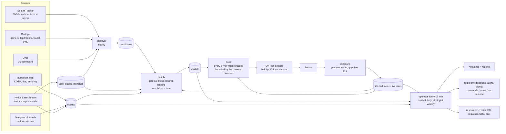

# snipetech — the loop, in one picture

Obsidian renders this diagram; the boxes link to the documents that define them.

Documents: [[roadmap]] (where we stand), [[live-recipe]] (every live test), the design in
`superpowers/specs/2026-11-06-learning-loop-design.md`, the plans under `superpowers/plans/`, [[birdeye]], [[jev]],
[[oktech-features]], [[oktech-settings]]. Live state: the dashboard at `/dash` on the server (phase 1, task 6).

## One database, many writers: every write is a short transaction

Every process on the server writes the same SQLite file (`snipetech.db`, WAL mode): the tape recorder about 100,000
trades an hour, the operator rounds and their jobs (events scan, qualify, the strategy search, the paper test, measure,
book, discover, the strategist). Readers never wait, but only one connection writes at a time, and the recorder waits at
most 20 s for its turn: on 7 Nov a lock held too long, then a refused write left open, stopped the tape for 1 h 45 min
(14:03-15:48), and a paper run that had waited 30 s for the lock died (14:06). So every writer goes through
`Store._write` and commits in short transactions: one row, one trade, one wallet, or a batch of `Store.WRITE_BATCH`
(500) rows, never one transaction across a lab, a network call or a whole table. A write that fails is rolled back at
once (an open transaction keeps the lock and pins the WAL); a refused one is retried for 10 minutes (20 s in the
recorder). The recorder's hourly prune clips the tape's coverage first, then deletes 500 rows per transaction as a task
of its own, the recorder going on in between (measured on a 2.4M-trade copy: another writer waited 2.0 s while one
transaction pruned an hour of tape, 12.4 s for six hours, and 0.08 s at most in batches; the server's database is ten
times larger). Each step of the prune reads at most `Store.PRUNE_SCAN` (5,000) rows, from where the last step stopped,
so a prune reads each old row once, as the single DELETE did. The first batched prune searched again from the oldest row
for every batch: across the trades a list protects, which pile up below the cutoff every day a wallet stays listed, and
through `seen_sigs`, which has no index on ts. Beside 199k protected trades an hour's prune took 43 s of the recorder's
loop, beside 4M 19 minutes in steps of 6 s; now 17 and 27 s in steps of 0.1 s (the single DELETE: 4 and 10 s, the lock
held throughout). Most of what is left is the WAL checkpoints its commits run: 3.3 s instead of 15.8 s with them off,
for an hour with no pile. A reader mid-run sees some of the batches: rows that each stand alone (trades, events,
fingerprints, paper trades, verdicts), so nothing it reads is half made, and during a prune a tape that starts at the
cutoff with some older rows still outside it. A job that dies leaves whole batches, never half of one, and its next run
writes the rest. A new index on a big table, or a table rebuilt, holds the lock for the whole build: run it once by hand
at a quiet hour, never as a line in `SCHEMA` that every process runs when it opens the database.
`tests/test_short_writes.py` guards the rule: a second connection writes while each writer is mid-run.

## Every read of the live file is short; the heavy readers read the hourly copy

A read holds its snapshot of the database until its last row. While it is open, no checkpoint can copy the WAL's newer
pages back into the file, and the WAL cannot start over from its beginning, so the `-wal` file grows with everything
the recorder writes. On 7 Nov the database plus its WAL (`db_gb` in `remote status`) grew about 2 GB an hour from 16:00
to 18:00 (15.1 to 19.3 GB, 11.3 before 14:03) and never shrank. The long reads behind it, measured on a 2.4M-trade copy
of the server's shape (the server holds 11M trades, mostly outside the memory its processes may use): discover's count
of buys by wallet and its hottest coins each walk the whole trades table through one index (14 s and 4 s cold; on the
server discover ran 34-50 minutes with 7-13 minutes of CPU and was killed at its 50-minute limit at 17:57 and 18:57),
the events scan walks it again (4 s, then a read per coin; one scan ran 16:46-17:18), and `paper freeze` ran a whole
lab on the live file (its list of a day's coins alone: 10 s). Those read `snipetech.ro.db` now, the copy `snapshot-db`
writes every hour (`Service.tape_store`, when it is under two hours old; the live file only when there is none): a
tape up to two hours old is fine for wallet discovery, research events and labs, and what they find on it is what they
found on the live file. Their results (candidates, events, frozen strategies) still go to the live file. The readers
that need the newest trades (the book, measure, the live and automatic tests, the paper test, the qualify gates) read
the live file in short reads: one wallet, one coin, or a span in pieces of `Store.READ_SPAN_SECS` (ten minutes; a day
of coins in 144 reads of at most 0.15 s instead of one of 9 s, the same answer), each read whole before the work on it.
`remote sql` and the analyst's `sql` tool stop a query at 30 s. The hourly copy is itself one read of the whole file,
8-10 minutes an hour (18:33:07-18:41:56 on 7 Nov); the backup API pins as long, so it stays. Every connection sets
`journal_size_limit` (64 MiB): once the WAL starts over, the file shrinks back instead of keeping its high-water mark.
`tests/test_short_reads.py` guards the rule: while each reader is mid-run, inside its longest read or between two, a
second connection checkpoints, and every frame must be checkpointed.
